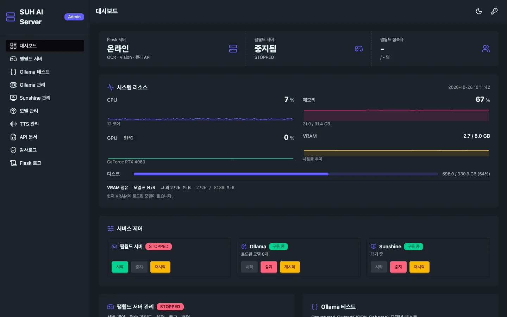
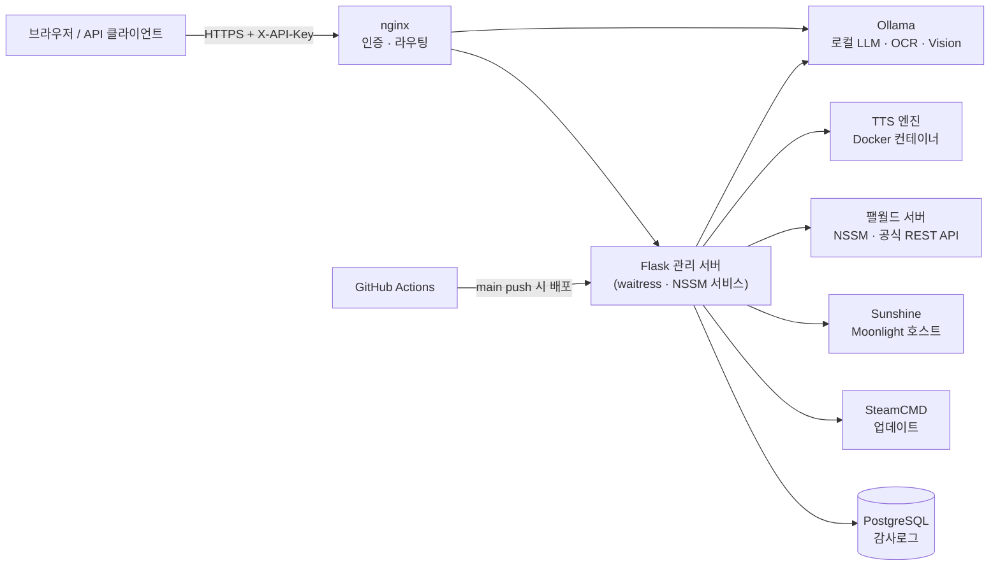
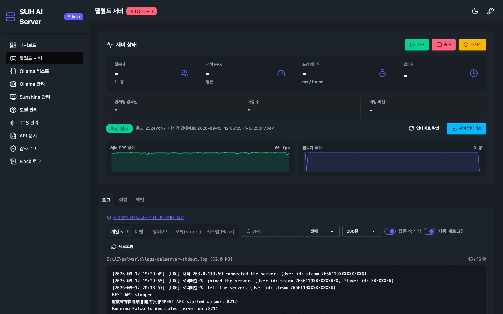
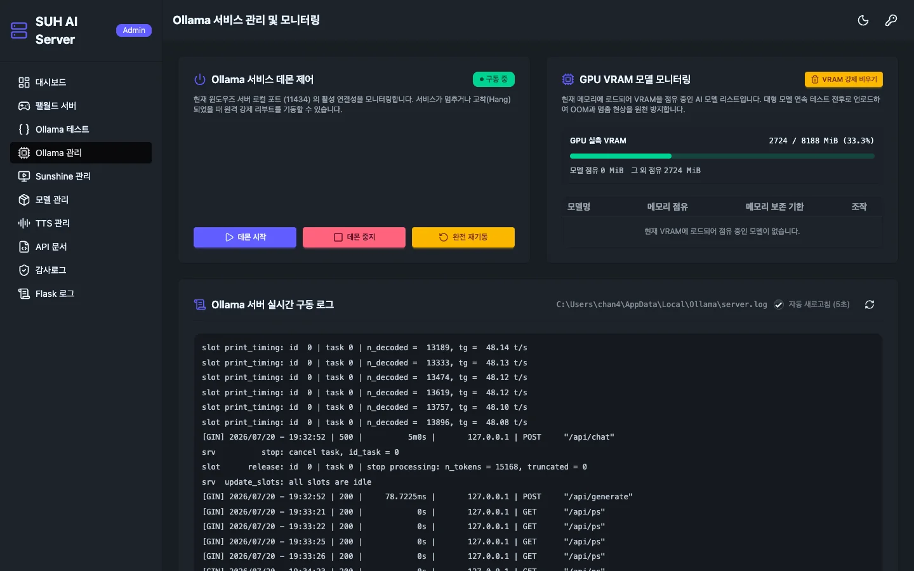
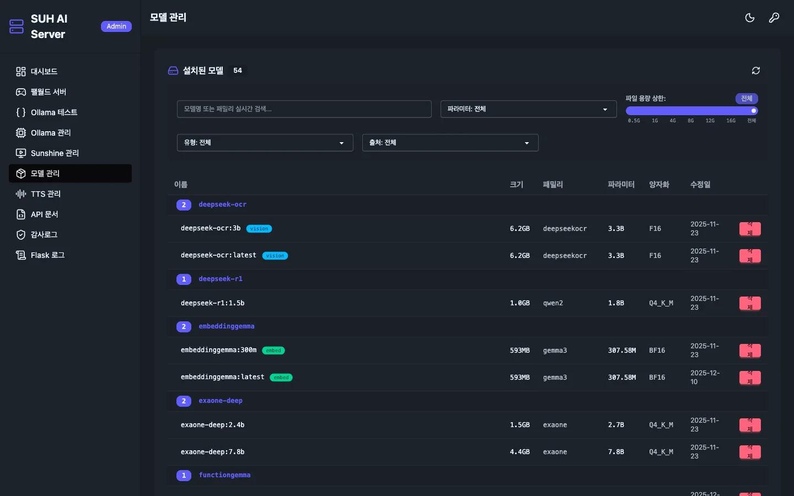
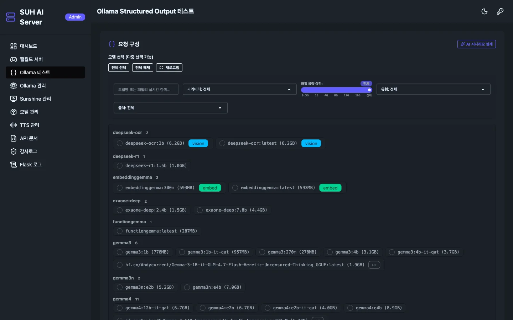
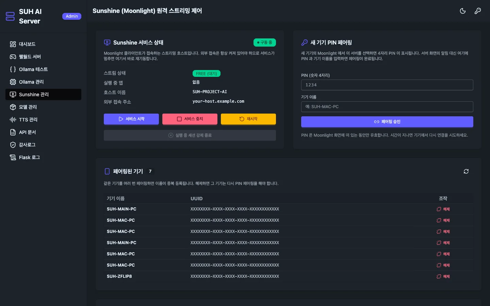
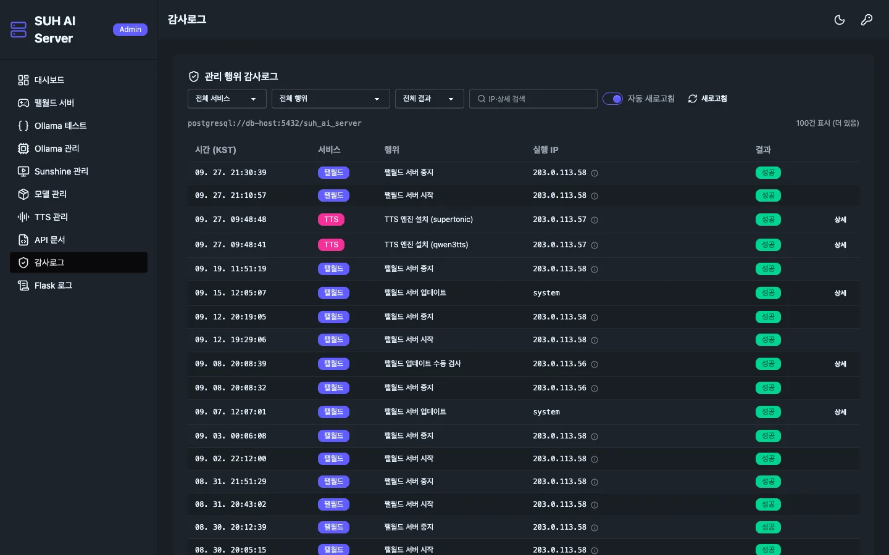
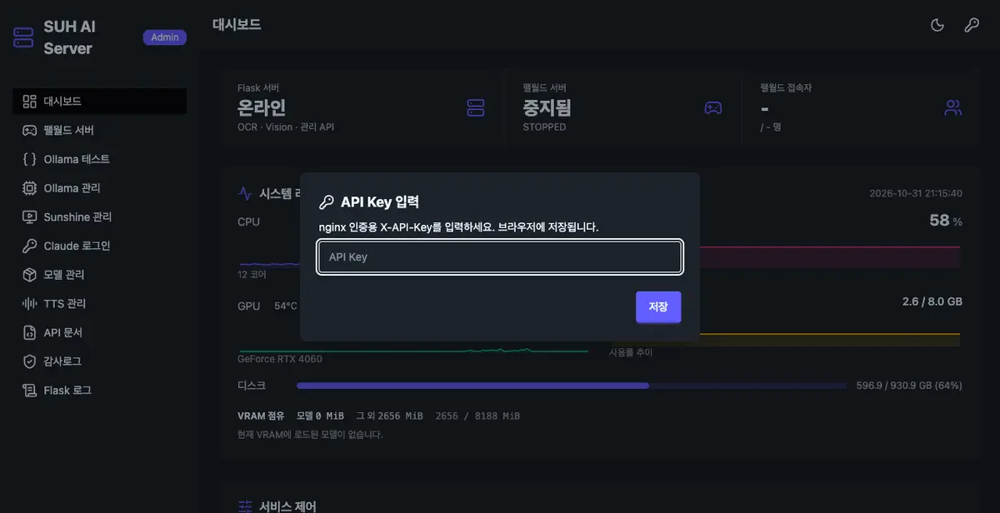
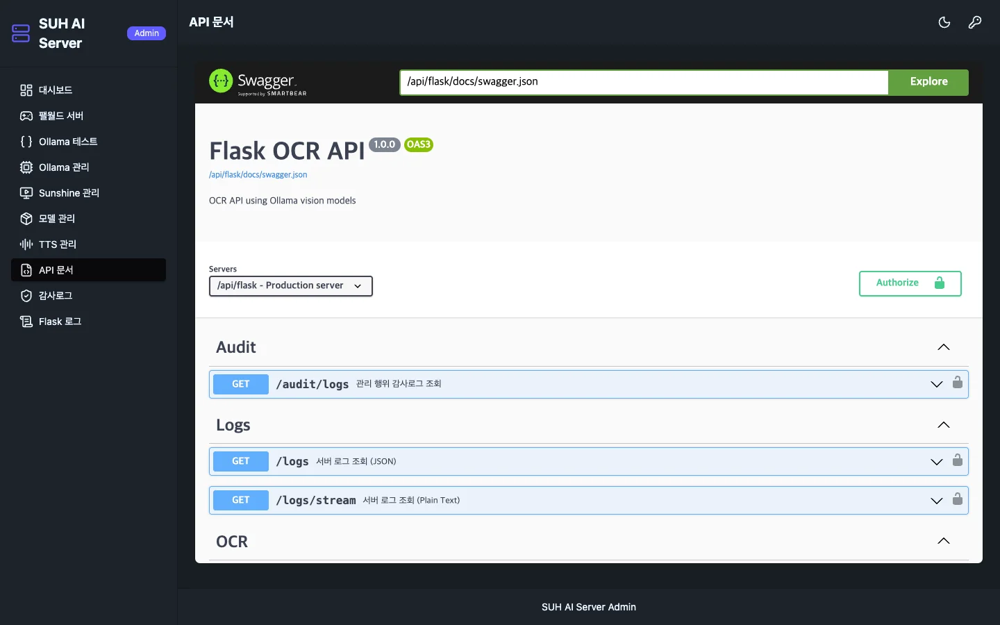

# 🧠 SUH-PROJECT-CONTROL
<!-- 수정하지마세요 자동으로 동기화 됩니다 -->
<!-- AUTO-VERSION-SECTION: DO NOT EDIT MANUALLY -->
## 최신 버전 : v2.0.84 (2026-11-08)

[전체 버전 기록 보기](CHANGELOG.md)
---

<div align="center">

### 집에 있는 GPU 한 장으로 AI API · 게임 서버 · 원격 스트리밍을 같이 돌리고, 전부 웹 한 화면에서 관리합니다

RTX 4060(8GB) 윈도우 홈서버 한 대에서 **로컬 LLM·OCR·TTS API**를 서빙하고,
남는 자원으로 **팰월드 데디케이티드 서버**와 **Moonlight 원격 스트리밍**까지 운영합니다.
SSH·원격 데스크톱으로 들어가지 않고 **브라우저 대시보드와 REST API**로 켜고 끄고 업데이트하고 기록합니다.




<sub>관리 대시보드: CPU·메모리·GPU·VRAM 실시간 그래프, VRAM 점유 분해, 팰월드·Ollama·Sunshine 원클릭 제어</sub>

</div>

---

## 📖 이게 무슨 서버인가

| | |
|---|---|
| **하드웨어** | Windows 데스크톱 1대 · 12코어 CPU · 31GB RAM · GeForce RTX 4060 8GB · 디스크 930GB |
| **하는 일** | ① 로컬 AI API(OCR·Vision·LLM·TTS) ② 팰월드 게임 서버 ③ Sunshine 원격 스트리밍 |
| **문제** | GPU 8GB를 AI 모델·TTS·게임이 나눠 써야 하고, 게임 서버는 재시작·설정·업데이트·백업 일이 끝없이 생김 |
| **해결** | 서비스마다 흩어진 관리 작업을 Flask 관리 서버 하나로 모으고, nginx `X-API-Key` 인증 뒤에 웹 대시보드·REST API로 노출 |



## ✨ 관리할 수 있는 것

| 영역 | 할 수 있는 일 |
|---|---|
| 📊 **대시보드** | CPU·메모리·GPU·VRAM·디스크 실시간 그래프, VRAM 점유 분해(모델 vs 그 외), 서비스 3개 시작·중지·재시작 |
| 🎮 **팰월드 서버** | 시작·중지·재시작, 접속자·FPS·프레임타임 시계열, `PalWorldSettings.ini` 웹 편집(가동 중 편집 차단), SteamCMD 새 빌드 감지 → 백업 → 업데이트 원클릭, 세이브 백업, 게임·이벤트·오류 로그 |
| 🧠 **Ollama 관리** | 데몬 시작·중지·완전 재기동, VRAM에 올라간 모델 목록과 강제 언로드, `server.log` 실시간 뷰어 |
| 📦 **모델 관리** | 설치 모델 검색·필터(파라미터·용량·유형·출처), Hugging Face GGUF 검색·다운로드 큐, 모델 삭제 |
| 🧪 **Ollama 테스트** | 여러 모델에 같은 Structured Output(JSON Schema) 요청을 한 번에 보내 결과·속도 비교, 벤치마크 기록 |
| 🔊 **TTS 관리** | 엔진 5종(CosyVoice2 · Supertonic · Qwen3-TTS · Chatterbox · Kokoro) 기동·중지, 보이스 등록, 합성 테스트 |
| 🖥️ **Sunshine** | Moonlight 스트리밍 상태, PIN 페어링, 페어링된 기기 해제, 실행 중 세션 강제 종료 |
| 📜 **감사로그** | 누가(IP) 언제 무엇을 했는지 PostgreSQL에 기록·필터 조회. DB가 죽어도 관리 기능은 막지 않는 fail-open |
| 📄 **API 문서 · 로그** | Swagger UI, Flask 서버 로그 레벨 필터·검색 |

## 📸 화면

<table>
  <tr>
    <td width="50%"><br><sub><b>팰월드</b> — 상태·FPS·접속자 추이, 업데이트 감지, 로그 탭</sub></td>
    <td width="50%"><br><sub><b>Ollama</b> — 데몬 제어, VRAM 모델 모니터링, 구동 로그</sub></td>
  </tr>
  <tr>
    <td><br><sub><b>모델 관리</b> — 설치 모델 검색·필터, HF GGUF 다운로드</sub></td>
    <td><br><sub><b>Ollama 테스트</b> — 여러 모델 JSON Schema 응답 비교</sub></td>
  </tr>
  <tr>
    <td><br><sub><b>Sunshine</b> — PIN 페어링, 기기 관리</sub></td>
    <td><br><sub><b>감사로그</b> — 서비스·행위·결과 필터</sub></td>
  </tr>
</table>

<sub>※ 캡처의 IP·UUID·호스트명·Steam ID는 공개용 가짜 값으로 바꿨습니다.</sub>

## 🤖 AI API

GPU에서 도는 모델을 REST로 바로 씁니다. 모든 요청은 nginx에서 `X-API-Key` 헤더로 인증합니다.

| 엔드포인트 | 설명 |
|---|---|
| `POST /ocr` · `/ocr/url` · `/ocr/base64` · `/ocr/upload` | 이미지 → 텍스트 (deepseek-ocr) |
| `POST /vision` · `/vision/url` · `/vision/base64` · `/vision/upload` | 비전 모델 이미지 분석·설명 |
| `POST /tts` · `GET /tts/voices` | 텍스트 → 음성 (선택한 TTS 엔진) |
| `POST /ollama/chat` · `/ollama/benchmark/batch` | 모델 호출 · 여러 모델 일괄 벤치마크 |
| `GET /system/metrics` | CPU·메모리·GPU·VRAM 지표 |
| `GET /health` | 헬스체크 (배포 스크립트·대시보드 연동) |

```bash
curl -X POST https://<host>/api/flask/ocr/url \
  -H "X-API-Key: <발급받은 키>" -H "Content-Type: application/json" \
  -d '{"url": "https://example.com/receipt.png"}'
```

**관리 화면 인증**: 대시보드 우측 상단 🔑 버튼에서 `X-API-Key`를 한 번 입력하면 브라우저에 저장되고, 이후 모든 관리 API 호출에 자동으로 붙습니다.



<details>
<summary>Swagger 화면 보기</summary>



</details>

## 🛠️ 기술 스택

| 영역 | 스택 |
|---|---|
| 백엔드 | Python · Flask · waitress · flask-swagger-ui |
| AI 추론 | Ollama (deepseek-ocr · 비전 · 범용 LLM) · TTS 엔진 Docker 이미지 — 전부 로컬 |
| 게임·스트리밍 | Palworld Dedicated Server · SteamCMD · Sunshine |
| 데이터 | PostgreSQL (감사로그, yoyo 마이그레이션) · jsonl 링버퍼 (메트릭 영속화) |
| 프론트 | Jinja2 · Tailwind CSS · daisyUI · lucide |
| 인프라 | Windows · NSSM 서비스 · nginx · GitHub Actions |

## 🚀 배포·운영 자동화

- `main` push → GitHub Actions가 소스를 서버로 올리고 PowerShell 스크립트(`suh-ai-server/scripts/deploy-*.ps1`)로 Flask·nginx·TTS를 재배포
- 버전 증가 · CHANGELOG · 릴리스 노트 · 이 README의 버전 줄까지 워크플로우가 자동 갱신
- 서비스는 NSSM 윈도우 서비스로 등록해 재부팅·크래시 뒤에도 자동 기동
- 테스트: `suh-ai-server/flask/test/` (pytest, 라우터·서비스 단위)

## 📁 폴더 구조

```
suh-ai-server/
├─ flask/        관리 서버 (router · service · templates · static · test)
├─ docker/       TTS 엔진별 Docker 이미지
├─ config/       nginx.conf (X-API-Key 인증 · 라우팅)
└─ scripts/      배포·초기 설정 PowerShell 스크립트
.github/         CI/CD 워크플로우 · 이슈/PR 템플릿
docs/            설계 문서 · 작업 보고서 · 화면 캡처
```

## 🗺️ 다음으로 붙일 기능

운영하면서 실제로 부딪힌 문제에서 나온 후보입니다.

- [ ] **GPU 자원 예약** — 8GB VRAM을 Ollama·TTS·게임이 나눠 쓰므로, 큰 모델 로드 전에 다른 GPU 작업을 자동 언로드하는 스케줄러
- [ ] **장애 알림** — 팰월드 크래시·업데이트 완료·VRAM 포화를 Discord/Slack 웹훅으로 전송
- [ ] **백업 자동화** — 세이브 백업 주기 실행 + NAS 복제 + 웹에서 복원
- [ ] **관리자 로그인** — 브라우저에 저장하는 API Key 대신 세션 로그인·역할(조회 전용 / 관리자) 분리
- [ ] **서비스 상태 정합성** — 데몬·컨테이너 제어 결과를 실제 기동 확인 후 표시 (지금은 실패해도 "실행 중"으로 보이는 경우 있음)
- [ ] **OpenAI 호환 게이트웨이** — 키별 사용량·요청 로그를 남기는 `/v1/chat/completions` 프록시
- [ ] **모바일 레이아웃** — 휴대폰에서도 서버 재시작·상태 확인

## 📄 라이선스

[MIT](LICENSE)
