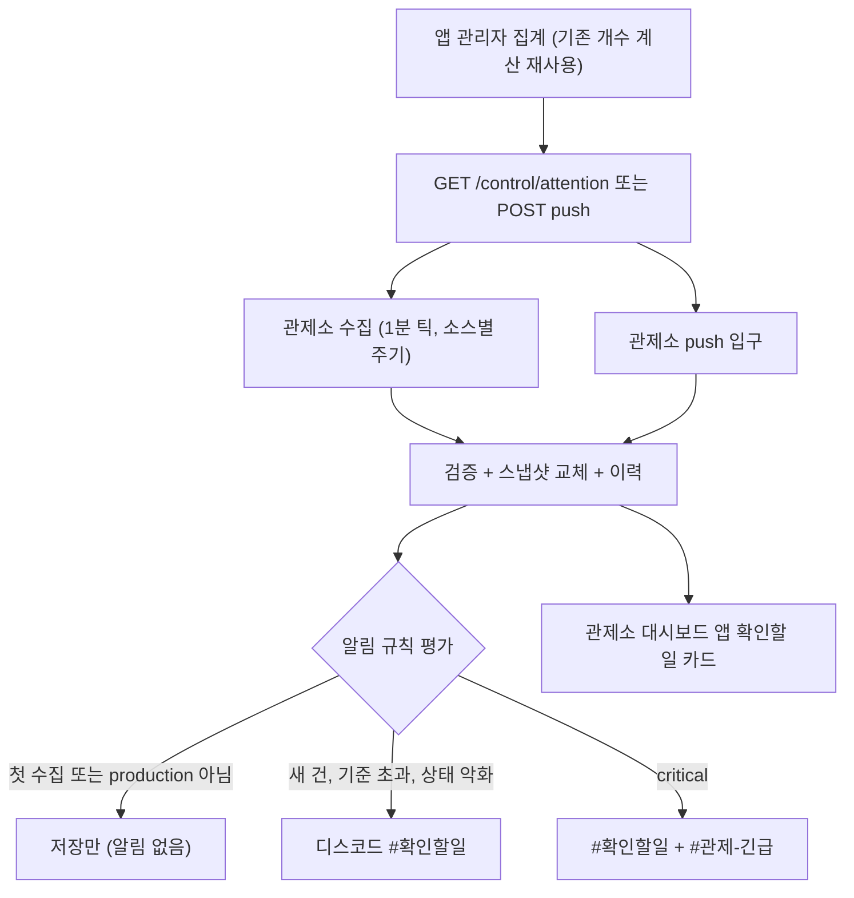

# 앱 확인할 일(attention) 연동 가이드

앱이 관리자 화면에서 보여 주는 "처리할 일"(새 의견, 처리 안 된 신고, 검토 대기, AI 이상, 비용 상한 등)을 관제소로 내보내는 규격(`attention v1`)과 연동 방법이다.
앱은 **사실(개수, 값, 상태)만** 같은 JSON 모양으로 내보내고, 어떤 항목을 보여 줄지, 이름, 수준, 알림 규칙은 관제소 관리 화면에서 정한다. 관제소는 이를 대시보드와 디스코드(#확인할일, 긴급은 #관제-긴급)로 알리고 앱 관리자 화면으로 바로 보낸다.
설계 배경은 [설계 문서](../../superpowers/specs/2026-11-08-control-tower-attention-integration-design.md)(#174)에 있고, 이 문서는 **구현된 코드 기준**이다. 설계와 다른 부분은 본문에 "코드 기준"으로 표시했다.



- 두 방식(pull, push) 모두 같은 본문, 같은 검증, 같은 처리 경로를 탄다.
- 본문은 **스냅샷 교체**다: 그 소스의 현재 항목 전체를 매번 보낸다(증분 아님). 한 번 빠져도 다음 스냅샷이 바로잡는다.
- `generated_at`이 이미 반영한 값 이하이면 버린다(stale). 앱은 **스냅샷을 만든 시각**을 UTC로 넣는다.
- `generated_at`이 관제소 시각보다 5분 넘게 미래면 `invalid`(`future_generated_at`)로 실패 처리한다(코드 기준: 미래 시각 1건이 이후 스냅샷을 모두 stale로 막지 않게).

## 1. 규격 요약

원본: [attention-v1.schema.json](./attention-v1.schema.json) (JSON Schema 2020-12). 예시: [examples/](./examples/) (`valid_*` 유효, `invalid_*` 무효). 관제소 검증기는 이 스키마와 같은 판정을 내리도록 테스트로 묶여 있다.

### 최상위

| 필드 | 필수 | 규칙 |
|---|---|---|
| `schema` | 예 | 고정 `"attention"` |
| `version` | 예 | `"주.부"` (예 `"1.0"`). 주 버전 1만 받는다. 부 버전은 무시 |
| `source.app` | 예 | 앱 식별 이름(화면, 로그 표시용) |
| `source.app_version` | 아니오 | 앱 버전 |
| `source.environment` | 아니오 | `production`(기본) / `staging` / `development`. production이 아니면 알림 없음 |
| `source.admin_base_url` | 아니오 | 상대 `admin_url`의 기준. **https 절대 주소만** (코드 기준: 아니면 최상위 위반 > 소스 전체 실패) |
| `generated_at` | 예 | UTC ISO 8601 (`2026-11-08T12:00:00Z`, 소수 9자리까지, `+09:00` 오프셋도 가능). 순서 판단 기준 |
| `poll_after_seconds` | 아니오 | 다음 수집 희망 간격. 관제소는 60~3600으로 자른 뒤 소스 `interval_seconds`와 비교해 **큰 값** 사용 |
| `items` | 예 | 0~100개. 0개도 정상 |

### 항목 공통

| 필드 | 필수 | 규칙 |
|---|---|---|
| `key` | 예 | `^[a-z][a-z0-9_]*(\.[a-z0-9_]+){1,3}$`, 64자 이하, 소스 안에서 유일(중복은 뒤의 것 버림) |
| `label` | 예 | 1~40자, 공백만은 불가 |
| `kind` | 예 | `count` / `gauge` / `state`. 모르는 kind도 받는다(label, detail, level만 표시, 알림은 수준 상승만) |
| `level` | 예 | `ok` / `info` / `warning` / `critical` (앱이 판단한 심각도) |
| `group` | 아니오 | 화면 묶음 이름, 20자 이하 |
| `description` | 아니오 | 200자 이하 |
| `admin_url` | 아니오 | 절대 https URL 또는 `/`로 시작하는 상대 경로(`admin_base_url`에 이어 붙임). http, 기준 없는 상대 경로는 **그 URL만 버림**(항목 유지) |
| `latest_at` | 아니오 | 가장 최근 건 시각(UTC ISO 8601) |
| `detail` | 아니오 | 한 줄 보충, 80자 이하 |

### kind별

| kind | 필드 | 의미 |
|---|---|---|
| `count` | `count` (필수, 0 이상 정수) | 지금 처리 안 된 개수 |
| | `total` (선택, 0 이상 정수) | 지금까지 생긴 누적 개수. 줄지 않는 값만. 있으면 "처리 1건 + 신규 1건"처럼 count가 그대로여도 새 건을 감지 |
| `gauge` | `value` (필수, 숫자) | 현재 값 |
| | `limit` (선택, 숫자), `unit` (선택, 12자 이하) | 상한, 단위. `limit`이 알림 기준의 기본값 |
| `state` | `state` (필수) | `ok` / `degraded` / `down` / `unknown` |

### 반드시 지킬 규칙

- **버전 규칙**: 필드를 추가하는 변경은 v1 유지(`1.1`처럼 부 버전만 올림). 의미를 바꾸거나 필드를 없앨 때만 주 버전을 올린다(v2). 관제소는 v1, v2를 함께 읽는다.
- **모르는 필드는 무시**한다(양쪽 모두). 그래서 필드를 더해도 구버전과 섞여도 깨지지 않는다.
- **0건 항목도 항상 내보낸다.** 관제소 관리 화면은 앱이 내보낸 항목으로 목록을 안다. 0건이라고 빼면 관리 화면에서 고를 수 없고, 한 번 정한 알림 기준도 끊긴다.
- **key는 불변**이다. 이력, 덮어쓰기, 알림 상태가 모두 key에 묶인다. 바꾸면 새 항목으로 취급된다. (스냅샷에서 빠진 항목은 바로 지우지 않고 숨긴 뒤 7일 후 삭제한다. 배포 실수로 잠깐 빠져도 복구된다.)
- 항목 하나가 규격 위반이면 **그 항목만** 버리고 사유를 기록한다. 최상위 위반(`schema`, `version`, `generated_at`, `items` 모양, 101개 이상 등)은 소스 전체 실패다.
- 본문 64KB 이하, 응답 5초 안(소스 설정 1~10초).

### 표준 key

같은 뜻이면 같은 key를 쓴다. 목록 밖은 `custom.이름`.

| key | kind | 뜻 |
|---|---|---|
| `feedback.new` | count | 처리 전 의견 |
| `feedback.in_progress` | count | 확인 중 의견 |
| `report.unresolved` | count | 처리 안 된 신고 |
| `review.pending` | count | 검토 대기 콘텐츠 |
| `job.stuck` | count | 멈춘 예약, 작업 |
| `job.failed` | count | 실패한 작업 |
| `payment.failed` | count | 결제 실패 |
| `ai.alert` | count | AI 이상 제공자 수 |
| `ai.provider` | state | AI 제공자 상태 |
| `budget.daily` | gauge | 오늘 비용 |
| `queue.backlog` | gauge | 대기열 길이 |

## 2. 전달 방식

소스(연동 단위)는 관제소 관리 화면에서 `(프로젝트, source_id)`로 등록하고 `mode`를 `pull` / `push` / `both` 중에서 고른다. 기본은 **pull**이다(관제소가 재배포돼도 다음 수집에서 그대로 복구).

### pull (기본): 관제소가 앱을 부른다

- `GET {등록한 url}` (예: `https://elum.example/control/attention`). url의 `${ENV}`는 관제소 환경변수로 치환된다.
- 헤더: `X-Control-Token: <수집 토큰>`, `Accept: application/json`, (이전 ETag가 있으면) `If-None-Match`.
- 리다이렉트는 따라가지 않는다(3xx는 오류).
- 주소 제한: https 아무 곳, http는 사설 IPv4(10/8, 172.16/12, 192.168/16, 127/8)이거나 `${`를 포함할 때만.
- 주기: 소스 `interval_seconds` (기본 60, 60~3600). 수집 틱이 60초라 그 아래는 의미 없다.

| 앱 응답 | 관제소 판정 | 비고 |
|---|---|---|
| 200 + 유효 본문 | 정상, 스냅샷 반영 | |
| 200 + 64KB 초과, JSON 아님, 최상위 위반 | `invalid` (실패) | 마지막 값 유지, 사유는 관리 화면에 표시 |
| 304 | 변화 없음(성공 시각만 갱신) | `ETag`를 주는 경우만 |
| 401, 403 | `unauthorized` | 토큰 틀림, 없음 |
| 404 | `disabled` | 앱 쪽 연동이 꺼져 있음 |
| 그 밖(5xx, 3xx, 204 등) | `error` (`http_<코드>`) | 일시 오류는 503 권장 |
| 소스 timeout 초과(기본 5초) | `timeout` | 느린 소스 하나가 다른 소스를 막지 않는다 |

- 실패해도 **마지막 값은 유지**된다. 연속 실패가 `stale_after_seconds`(기본 interval×5)를 넘으면 프로젝트 `error` 채널에 "연동 끊김" 1번, 복구 시 1번 알린다(같은 프로젝트 서비스가 down이면 끊김 알림은 생략).
- `ETag`는 선택이다. 쓰려면 `generated_at`을 뺀 내용으로 만들어야 의미가 있다(매번 바뀌는 값이 섞이면 304가 나오지 않는다).

### push (선택): 앱이 관제소로 보낸다

- `POST https://ai.suhsaechan.kr/api/flask/control/attention/{project}/{source}` (API 키 검사 제외 경로, nginx 64KB 제한).
- 헤더: `X-Control-Token: <프로젝트 이벤트 토큰>` (기존 `/control/events`와 같은 토큰), `Content-Type: application/json`.
- 본문: pull 응답과 같은 스냅샷.
- **변화가 없어도 최소 5분마다** 스냅샷을 보낸다(관제소의 끊김 판정 기준). push 전용 소스의 `stale_after_seconds` 기본값은 `max(interval×5, 600)`이다(코드 기준: 설계는 interval×5. 5분 주기와 겹쳐 오탐하지 않게 올림).
- 즉시 알리고 싶은 변화가 있을 때 추가로 보내면 된다. 같은 항목의 `new` 알림은 10분에 1번으로 묶인다.

| 응답 | 뜻 |
|---|---|
| 202 `{"result": ..., "dropped_items": [...]}` | 접수. `result`가 `ok`면 반영, `stale`(오래된 스냅샷 버림), `conflict`(동시 반영에 밀림, 다음에 다시), `invalid`(최상위 위반, 실패로 기록). **규격 위반도 202**이니 `result`와 `dropped_items`를 확인할 것 |
| 400 `invalid` | JSON 아님 |
| 401 `unauthorized` | 토큰 틀림, 없음 |
| 403 `push_disabled` | 소스 mode가 pull |
| 403 `source_disabled` | 소스가 꺼져 있음 (코드 기준 추가 응답) |
| 404 `unknown_source` | 등록 안 된 소스 |
| 413 `too_large` | 64KB 초과 |
| 503 `unavailable` | 관제소 준비 안 됨 |

## 3. 토큰

방향마다 토큰이 다르다(한쪽이 유출돼도 양방향 위조로 이어지지 않게). 값은 DB에 두지 않고 환경변수만 쓴다. 관리 화면에는 "설정됨/없음"만 보인다.

| 방향 | 관제소 환경변수 | 앱 쪽 |
|---|---|---|
| pull (관제소 > 앱) | `CONTROL_PULL_TOKEN_<PROJECT>__<SOURCE>` | 앱이 같은 값을 환경변수로 가지고 상수 시간 비교로 검증 (앱 쪽 변수 이름은 자유) |
| push (앱 > 관제소) | `CONTROL_EVENT_TOKEN_<PROJECT>` | 앱이 같은 값을 헤더에 실어 보냄 |
| 교체용 이전 값 | 위 이름 뒤에 `_PREVIOUS` (예 `CONTROL_EVENT_TOKEN_ELUM_PREVIOUS`) | 앱도 현재 + 이전 2개를 허용 |

- `<PROJECT>`, `<SOURCE>`는 id를 대문자로, `-`는 `_`로 바꾼 값이다. 예: 프로젝트 `elum`, 소스 `api` > `CONTROL_PULL_TOKEN_ELUM__API`. 프로젝트 `pass-ql` > `CONTROL_EVENT_TOKEN_PASS_QL`.
- 프로젝트와 소스 사이 구분자는 밑줄 **2개**다. `source_id`는 `^[a-z][a-z0-9]*$`, 20자 이하(`-`, `_` 금지)라서 환경변수 이름이 겹칠 수 없다.
- 관제소가 보내는 pull 토큰은 **현재 값만** 쓴다. 관제소가 받는 push 토큰은 현재 + `_PREVIOUS`를 모두 허용한다.
- 환경변수는 서버 시작 때 `.env`에서 읽히므로 값을 바꾸면 **관제소 재배포**가 필요하다.

### 무중단 교체 절차

pull 토큰 (앱이 받는 쪽):
1. 앱에 새 토큰을 현재, 기존 토큰을 이전으로 넣고 배포(둘 다 허용).
2. 관제소 `CONTROL_PULL_TOKEN_...`을 새 값으로 바꾸고 재배포.
3. 연결 확인으로 정상 수집을 본 뒤 앱의 이전 토큰을 제거하고 배포.

push 토큰 (관제소가 받는 쪽):
1. 관제소에 `CONTROL_EVENT_TOKEN_<PROJECT>`=새 값, `..._PREVIOUS`=기존 값을 넣고 재배포.
2. 앱의 push 토큰을 새 값으로 바꾸고 배포.
3. 앱이 새 토큰으로 정상 push하는 것을 본 뒤 관제소에서 `_PREVIOUS`를 제거하고 재배포.

## 4. 앱 관리자 화면 "관제소 연동" 섹션

앱 관리자 화면에 아래를 둔다(값은 앱 자체 설정이며 관제소 표시 설정은 두지 않는다).

- 연동 켜기/끄기 (끄면 `GET /control/attention`은 404)
- 마지막 관제소 수집 시각 (마지막으로 토큰 검증을 통과한 요청 시각)
- 수집 토큰 설정 여부 (**값은 표시하지 않는다**, "설정됨/없음"만)
- 현재 내보내는 항목 미리보기 (실제 응답과 같은 서비스가 만든 데이터)

항목 표시 여부, 이름, 수준 기준, 알림 규칙은 **앱이 아니라 관제소**에서 정한다. 앱은 사실만 내보낸다.

## 5. 관제소 등록 절차

1. **앱 배포**: `GET /control/attention`(와 필요하면 push)을 포함해 배포한다. 앱의 보안 설정에서 이 경로는 자체 토큰으로 검증하므로 기존 로그인 인증 대상에서 제외한다.
2. **서버 env 등록**: 관제소 서버의 환경변수에 토큰을 추가한다. GitHub 시크릿 `FLASK_ENV_FILE`(배포 때 서버 `.env`가 됨)에 `CONTROL_PULL_TOKEN_<PROJECT>__<SOURCE>`(pull), `CONTROL_EVENT_TOKEN_<PROJECT>`(push)를 더하고 **관제소를 재배포**한다.
3. **관리 탭 > 프로젝트 행 > 앱 연동 추가**: 프로젝트(관제소에 등록된 프로젝트만), `source_id`, 방식, url, 주기를 입력한다.
4. **연결 확인**: 즉시 1회 요청해 결과 코드, 규격 위반 항목, 항목 미리보기를 보여 준다. DB, 기준선, 알림 상태는 바꾸지 않는다.
5. **첫 수집은 기준선**: 소스의 첫 성공 수집은 저장만 하고 알림이 없다(등록 직후, DB 초기화 후 몰아치기 방지). 관제소를 재배포해도 DB가 남아 기준선은 유지된다.
6. **이후 알림**: 기준선 뒤 변화부터 `#확인할일` 채널(info, warning)로 간다. critical은 `#확인할일` + `#관제-긴급`. 프로젝트 `#확인할일` 채널은 소스가 1개 이상 등록된 프로젝트에만 만들어지며, 디스코드 동기화 전에는 `#관제-긴급`으로 대신 간다.
7. 관리 화면의 소스 상세 항목 표에서 항목별 표시, 이름, 수준, 알림 규칙을 조정한다(앱이 보낸 원래 값은 회색으로 옆에 표시).

## 6. 알림 규칙

항목별 유효 설정은 **관제소 덮어쓰기 > kind 기본값**이다.

| 규칙(`alert_rule`) | 기본 적용 | 언제 알림 |
|---|---|---|
| `new` | count | 새 건이 생겼을 때. `total`이 있으면 total 증가분, 없으면 count 증가분(줄어든 것은 알리지 않음) |
| `threshold` | gauge | value가 기준(덮어쓰기 `threshold` > 항목 `limit`) **이상**으로 넘어갈 때 1번, 내려오면 해소 1번. 기준이 없으면 알림 없음 |
| `state` | state | ok가 아닌 상태로 바뀔 때(비정상끼리 변화 포함), ok로 돌아올 때 |
| `level` | 모르는 kind | 유효 수준이 warning 이상으로 올라갈 때 |
| `off` | | 알림 없음(대시보드만) |

공통 억제와 묶음

- 첫 성공 수집(기준선), `environment`가 production이 아닌 소스, 유효 수준 ok 항목은 알림이 없다. 알림이 없어도 비교 기준 값은 현재 값으로 갱신된다.
- 새로 추가된 key는 기준 값이 없으므로 알리지 않고 기준만 저장한다(앱이 항목을 추가해도 기존 적체가 한꺼번에 알림으로 쏟아지지 않음).
- 한 소스의 한 번 처리에서 나온 알림은 메시지 1건으로 묶는다(항목별 줄, 높은 수준 먼저).
- `new` 쿨다운: 같은 항목은 10분에 1번. 그 사이 늘어난 건은 다음 알림에 합산("+5, 지금 8건").
- 디스코드 발송이 실패하면(전달 안 됨, 예외) 그 알림에 담긴 항목은 비교 기준과 보낸 시각을 처리 전 값으로 남겨 다음 처리에서 다시 평가한다(`new`는 증가분을 쌓아 두었다가 합쳐 보냄). 연동 끊김/복구 알림도 같다. 프로젝트 채널로 전달된 항목은 전역 긴급만 실패해도 다시 보내지 않는다. 디스코드가 설정되지 않은 서버에서는 되돌리지 않는다.
- gauge는 기본이 `threshold`라서 앱이 `level`을 warning으로 올려도(예: 상한의 80%) 알림은 value가 limit 이상일 때만 나간다. 80%에서 알리려면 관제소에서 `alert_rule`을 `level`로 바꾸거나 `threshold`를 낮춘다.
- 연동 끊김/복구는 프로젝트 `error` 채널.

관제소에서 덮어쓸 수 있는 것(항목별, null이면 해제): 표시 여부(`is_hidden`), 이름(`label`), 수준 정책(`level_policy`: `app`=앱 값, `info`/`warning`/`critical` 고정, `ok`=정보성), 알림 규칙, 기준값(`threshold`), 알림 채널 종류(`attention`/`status`/`error`/`report`). 소스 단위로는 사용 여부, 방식, url, 주기, timeout, stale 기준. **값(count, value, state), key, kind는 덮어쓸 수 없다.**

## 7. Spring 참조 구현 (Java 17+, Spring Boot)

컨트롤러, 응답 record, 토큰 검사, 기존 집계 재사용 예시다. 패키지, 의존성 이름은 앱에 맞게 바꾼다.

- JSON 이름(snake_case)은 `@JsonProperty`로 지정했다(Jackson 2/3 어느 쪽이든 어노테이션 패키지가 같아 버전에 상관없이 동작).
- `Instant`가 ISO 문자열로 나가야 한다(Spring Boot 기본 설정이면 그렇다).
- `@ConfigurationProperties` record를 쓰려면 `@ConfigurationPropertiesScan` 또는 `@EnableConfigurationProperties`가 필요하다.

### 설정

```yaml
control:
  attention:
    is-enabled: ${CONTROL_ATTENTION_ENABLED:false}   # 끄면 404
    pull-token: ${CONTROL_PULL_TOKEN:}               # 관제소 CONTROL_PULL_TOKEN_<PROJECT>__<SOURCE> 와 같은 값
    pull-token-previous: ${CONTROL_PULL_TOKEN_PREVIOUS:}
    admin-base-url: ${ADMIN_BASE_URL:}               # https 절대 주소, 비우면 상대 admin_url 생략
    environment: ${APP_ENVIRONMENT:production}       # production / staging / development
    push-url: ${CONTROL_PUSH_URL:}                   # 비우면 push 안 함 (https://ai.suhsaechan.kr/api/flask/control/attention/{project}/{source})
    push-token: ${CONTROL_EVENT_TOKEN:}
```

```java
@ConfigurationProperties(prefix = "control.attention")
public record AttentionProperties(
    boolean isEnabled, String pullToken, String pullTokenPrevious,
    String adminBaseUrl, String environment, String pushUrl, String pushToken) {
}
```

### 응답 record

```java
public enum AttentionLevel {
  OK, INFO, WARNING, CRITICAL;

  @JsonValue
  public String toJsonValue() {
    return name().toLowerCase(Locale.ROOT);
  }
}

@JsonInclude(JsonInclude.Include.NON_NULL)
public record AttentionSource(
    String app,
    @JsonProperty("app_version") String appVersion,
    String environment,
    @JsonProperty("admin_base_url") String adminBaseUrl) {
}

@JsonInclude(JsonInclude.Include.NON_NULL)
public record AttentionItem(
    String key, String label, String kind, AttentionLevel level,
    String group, String description,
    @JsonProperty("admin_url") String adminUrl,
    @JsonProperty("latest_at") Instant latestAt,
    String detail,
    Long count, Long total,          // count
    Double value, Double limit, String unit,  // gauge
    String state) {                  // state: ok / degraded / down / unknown

  public static AttentionItem count(String key, String label, long count, AttentionLevel level) {
    return new AttentionItem(key, label, "count", level, null, null, null, null, null,
        count, null, null, null, null, null);
  }

  public static AttentionItem gauge(String key, String label, double value, Double limit, String unit,
      AttentionLevel level) {
    return new AttentionItem(key, label, "gauge", level, null, null, null, null, null,
        null, null, value, limit, unit, null);
  }

  public static AttentionItem state(String key, String label, String state, AttentionLevel level) {
    return new AttentionItem(key, label, "state", level, null, null, null, null, null,
        null, null, null, null, null, state);
  }

  /** 상대 경로("/feedbacks?status=NEW") 또는 https 절대 주소 */
  public AttentionItem withAdminUrl(String adminUrl) {
    return new AttentionItem(key, label, kind, level, group, description, adminUrl, latestAt, detail,
        count, total, value, limit, unit, state);
  }

  /** 줄지 않는 누적 개수일 때만 사용 (삭제가 있으면 넣지 않는다) */
  public AttentionItem withTotal(long total) {
    return new AttentionItem(key, label, kind, level, group, description, adminUrl, latestAt, detail,
        count, total, value, limit, unit, state);
  }
}

@JsonInclude(JsonInclude.Include.NON_NULL)
public record AttentionResponse(
    String schema, String version, AttentionSource source,
    @JsonProperty("generated_at") Instant generatedAt,
    @JsonProperty("poll_after_seconds") Integer pollAfterSeconds,
    List<AttentionItem> items) {

  public static AttentionResponse of(AttentionSource source, List<AttentionItem> items) {
    return new AttentionResponse("attention", "1.0", source,
        Instant.now().truncatedTo(ChronoUnit.MILLIS), null, items);
  }
}
```

### 토큰 검사 (현재 + 이전, 상수 시간)

```java
@Component
public class AttentionTokenChecker {

  private final List<byte[]> acceptedTokens;

  public AttentionTokenChecker(AttentionProperties properties) {
    this.acceptedTokens = Stream.of(properties.pullToken(), properties.pullTokenPrevious())
        .filter(token -> token != null && !token.isBlank())   // 비어 있는 토큰은 허용 목록에서 제외
        .map(token -> token.getBytes(StandardCharsets.UTF_8))
        .toList();
  }

  public boolean isValid(String presentedToken) {
    if (presentedToken == null) {
      return false;
    }
    byte[] presentedBytes = presentedToken.getBytes(StandardCharsets.UTF_8);
    boolean isMatched = false;
    for (byte[] acceptedToken : acceptedTokens) {
      isMatched |= MessageDigest.isEqual(acceptedToken, presentedBytes);   // 일치해도 끝까지 비교
    }
    return isMatched;
  }
}
```

### 컨트롤러

```java
@RestController
public class ControlAttentionController {

  private static final String TOKEN_HEADER_NAME = "X-Control-Token";
  private static final Logger log = LoggerFactory.getLogger(ControlAttentionController.class);

  private final AttentionProperties properties;
  private final AttentionTokenChecker tokenChecker;
  private final AttentionSnapshotService snapshotService;

  public ControlAttentionController(AttentionProperties properties, AttentionTokenChecker tokenChecker,
      AttentionSnapshotService snapshotService) {
    this.properties = properties;
    this.tokenChecker = tokenChecker;
    this.snapshotService = snapshotService;
  }

  /** 관제소 수집용 스냅샷: 켜짐 확인 > 토큰 검증 > 집계 */
  @GetMapping("/control/attention")
  public ResponseEntity<AttentionResponse> getAttention(
      @RequestHeader(value = TOKEN_HEADER_NAME, required = false) String presentedToken) {
    if (!properties.isEnabled()) {
      return ResponseEntity.notFound().build();                                   // 404 연동 꺼짐
    }
    if (!tokenChecker.isValid(presentedToken)) {
      return ResponseEntity.status(HttpStatus.UNAUTHORIZED).build();              // 401
    }
    try {
      return ResponseEntity.ok().cacheControl(CacheControl.noStore()).body(snapshotService.buildSnapshot());
    } catch (RuntimeException exception) {
      log.warn("[control attention] snapshot failed : {}", exception.getMessage());
      return ResponseEntity.status(HttpStatus.SERVICE_UNAVAILABLE).build();       // 503 관제소는 마지막 값 유지
    }
  }
}
```

### 집계 재사용 (기존 관리자 대시보드 집계 위에서 항목만 만든다)

```java
@Service
public class AttentionSnapshotService {

  private static final double BUDGET_WARNING_RATIO = 0.8;   // 상한 80% 이상 warning, 100% 이상 critical

  private final AttentionProperties properties;
  private final FeedbackRepository feedbackRepository;
  private final AdminDashboardService adminDashboardService;   // 기존 대시보드 집계 (AdminDashboardAttention)

  // 생성자 주입 생략 (필드 3개 + 속성)

  public AttentionResponse buildSnapshot() {
    AdminDashboardAttention attention = adminDashboardService.getAttention();
    AttentionSource source = new AttentionSource("elum-server", null, properties.environment(),
        blankToNull(properties.adminBaseUrl()));
    // 0건이어도 모든 항목을 항상 내보냄
    return AttentionResponse.of(source, List.of(
        feedbackNew(),
        budgetDaily(attention)));
  }

  /** 새 의견: 기존 건수 조회 > count 항목 (PENDING 외 상태는 새 의견이 아님) */
  private AttentionItem feedbackNew() {
    long pendingCount = feedbackRepository.countByStatus(FeedbackStatus.PENDING);
    AttentionLevel level = pendingCount > 0 ? AttentionLevel.INFO : AttentionLevel.OK;
    return AttentionItem.count("feedback.new", "새 의견", pendingCount, level)
        .withAdminUrl("/feedbacks?status=PENDING");   // admin_base_url 기준 상대 경로
  }

  /** 오늘 AI 비용: budgetUsd -1이면 상한 꺼짐(limit 생략), 아니면 사용률로 수준 결정 */
  private AttentionItem budgetDaily(AdminDashboardAttention attention) {
    Double limit = attention.isBudgetEnabled() ? attention.budgetUsd() : null;
    AttentionLevel level = AttentionLevel.OK;
    if (limit != null && limit > 0) {
      double usedRatio = attention.spentUsd() / limit;
      level = usedRatio >= 1 ? AttentionLevel.CRITICAL
          : usedRatio >= BUDGET_WARNING_RATIO ? AttentionLevel.WARNING : AttentionLevel.OK;
    }
    return AttentionItem.gauge("budget.daily", "오늘 AI 비용", attention.spentUsd(), limit, "USD", level)
        .withAdminUrl("/ai/budget");
  }

  private static String blankToNull(String text) {
    return text == null || text.isBlank() ? null : text;
  }
}
```

앱별 매핑 예시: elum은 `AdminDashboardAttention`/`AdminSidebarBadges`의 새 의견(`feedback.new`), 검토 대기 일과(`review.pending`), 멈춘 예약(`job.stuck`), AI 이상(`ai.alert`), 오늘 비용(`budget.daily`), 처리 안 된 신고(`report.unresolved`)를 그대로 항목으로 옮긴다. passQL은 `FeedbackRepository.countByStatus`로 `PENDING` > `feedback.new`, `REVIEWED` > `feedback.in_progress`를 만든다.

### push 보내기 (선택, 5분 스냅샷)

```java
@Component
@ConditionalOnExpression("!'${control.attention.push-url:}'.isBlank()")   // push-url이 있을 때만 (@EnableScheduling 필요)
public class AttentionPushSender {

  private static final Logger log = LoggerFactory.getLogger(AttentionPushSender.class);

  private final AttentionProperties properties;
  private final AttentionSnapshotService snapshotService;
  private final RestClient restClient = RestClient.create();

  // 생성자 주입 생략

  /** 변화가 없어도 5분마다 현재 스냅샷 전송 (관제소 끊김 판정 기준). 즉시 알리고 싶으면 같은 메서드를 추가로 호출 */
  @Scheduled(fixedRate = 300_000)
  public void pushSnapshot() {
    try {
      restClient.post().uri(properties.pushUrl())
          .header("X-Control-Token", properties.pushToken())
          .contentType(MediaType.APPLICATION_JSON)
          .body(snapshotService.buildSnapshot())
          .retrieve()
          .toBodilessEntity();   // 202여도 본문 result(stale, invalid)는 연결 확인으로 점검
    } catch (RuntimeException exception) {
      log.warn("[control attention] push failed : {}", exception.getMessage());
    }
  }
}
```

## 8. 하지 말 것

- **개인정보, 본문, 개별 건 목록을 보내지 않는다.** 개수, 값, 상태, 한 줄 요약(`detail`)만. 사용자 이름, 이메일, 의견 내용은 넣지 않는다(`detail`, `label`에도).
- **key를 바꾸지 않는다.** 이름을 고치고 싶으면 `label`을 바꾼다.
- **0건 항목을 빼지 않는다.** 항상 모든 항목을 내보낸다.
- 증분(이벤트)이 아니라 **현재 전체 스냅샷**을 보낸다. 부분 목록을 보내면 나머지는 빠진 것으로 취급된다(숨김 > 7일 뒤 삭제).
- `generated_at`을 고정값이나 과거 시각으로 쓰지 않는다(이미 반영한 값 이하면 버려진다). 캐시한 응답을 새 시각으로 다시 포장하지도 않는다.
- 관제소 표시 설정(어떤 항목을 보여 줄지, 알림 여부)을 앱에 넣지 않는다. 단일 원본은 관제소다.
- 토큰을 로그, 응답, 관리자 화면에 노출하지 않는다. 비교는 상수 시간으로, pull과 push 토큰을 같은 값으로 쓰지 않는다.
- 응답을 무겁게 만들지 않는다: 5초 안, 64KB 이하, 100개 이하. 집계는 기존 대시보드의 가벼운 조회를 재사용하고 요청마다 전체 스캔을 하지 않는다.
- `environment`를 운영 서버에서 `production`이 아닌 값으로 두지 않는다(알림이 꺼진다). 반대로 스테이징은 반드시 `staging`으로 표시한다.
- 규격을 어기는 응답(`kind`와 필드 불일치, 소문자가 아닌 key, 40자 초과 label)을 내보내지 않는다. 연결 확인의 `dropped_items`가 비어 있는지 본다.
