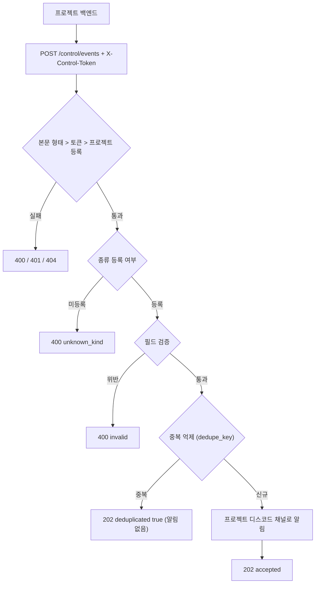

# 앱 이벤트(events) 연동 가이드

프로젝트(서버, 배치, 도구)가 "지금 일어난 일"(에러, 배포 완료, 신고 접수, 인증코드 발급 등)을 관제소로 보내면, 관제소가 그 프로젝트의 디스코드 채널로 알림을 보내는 규격(`events v1`)이다.
보내는 쪽은 **사실(종류, 수준, 제목, 본문)만** 보내고, 어느 채널로 갈지와 누가 볼 수 있는지는 관제소 관리 화면에서 정한다.
이 문서는 **구현된 코드 기준**이다(`router/control_tower_router.py`, `service/control_tower/event_dispatcher.py`).



## 1. 요청

| 항목 | 값 |
|---|---|
| 주소 | `POST https://ai.suhsaechan.kr/api/flask/control/events` |
| 헤더 | `X-Control-Token: <프로젝트 토큰>`, `Content-Type: application/json` |
| 본문 | 아래 필드 표 (JSON 객체) |

원본 스키마: [events-v1.schema.json](./events-v1.schema.json) (JSON Schema 2020-12). 예시: [examples/](./examples/) (`valid_*` 유효, `invalid_*` 무효).
스키마의 길이, 개수 상한은 서버 검증기 상수와 같아야 하며 계약 테스트(`test/test_control_tower_events_contract.py`)가 비교한다.

### 필드

| 필드 | 필수 | 규칙 |
|---|---|---|
| `project` | 예 | 관제소에 등록된 프로젝트 id(문자열). 토큰의 주인이기도 하다 |
| `kind` | 예 | 알림 종류. 기본 `report`, `error`, `deploy`, `status`, `info` + 프로젝트별로 추가한 종류. 미등록이면 `unknown_kind` |
| `severity` | 예 | `info` / `warning` / `critical` |
| `title` | 예 | 1~200자 |
| `body` | 아니오 | 2000자 이하 |
| `url` | 아니오 | `https://`로 시작, 2048자 이하 (알림의 링크) |
| `dedupe_key` | 아니오 | 문자열. 같은 (프로젝트, 종류, 키)가 짧은 시간 안에 다시 오면 알림 없이 접수만 한다 |
| `fields` | 아니오 | `[{ "name", "value" }]` 최대 10개, `name` 1~40자, `value` 1~200자, 둘 다 문자열 |

- 모르는 최상위 필드는 무시한다.
- `info` 종류는 프로젝트 상태 채널로, 그 외 종류는 같은 이름의 채널로 간다. 채널이 없으면 관제-긴급 채널로 대체된다.

## 2. 응답

| 코드 | 본문 | 뜻 |
|---|---|---|
| 202 | `{"accepted": true, "deduplicated": false}` | 접수 완료. 디스코드 발송이 실패해도 접수 응답이다(재전송 불필요) |
| 202 | `{"accepted": true, "deduplicated": true}` | `dedupe_key` 중복. 알림 없음 |
| 400 | `{"error": "invalid", "fields": ["title", ...]}` | 본문이 객체가 아니거나 `project`가 문자열이 아님(`fields: ["project"]`), 또는 필드 규칙 위반(위반 필드 이름 목록) |
| 400 | `{"error": "unknown_kind", "kind": "..."}` | 이 프로젝트에 등록되지 않은 종류. 기록, 알림 없음. `kind`는 50자까지 되돌려 준다 |
| 401 | `{"error": "unauthorized"}` | 토큰 없음, 불일치, 서버에 해당 프로젝트 토큰 미설정 |
| 404 | `{"error": "unknown_project"}` | 토큰은 맞지만 관제소에 등록되지 않은 프로젝트 |
| 503 | `{"error": "unavailable"}` | 관제소 준비 안 됨(기동 중, 설정 오류). 잠시 뒤 재시도 |

처리 순서는 본문 형태 > 토큰 > 프로젝트 등록 > 종류 > 필드 검증이다.

## 3. 토큰

- 프로젝트마다 하나. 서버 환경변수 `CONTROL_EVENT_TOKEN_<PROJECT>`에 둔다(`<PROJECT>`는 프로젝트 id를 대문자로, `-`는 `_`로: `suh-ai` > `CONTROL_EVENT_TOKEN_SUH_AI`).
- 교체 중에는 `CONTROL_EVENT_TOKEN_<PROJECT>_PREVIOUS`에 이전 값을 함께 두면 둘 다 통과한다. 보내는 쪽 교체가 끝나면 이전 값을 지운다.
- 관리 화면에서 토큰을 발급하는 기능과 Java, Python 클라이언트 라이브러리는 이후 단계에서 제공할 예정이다(설계 문서 2단계, 4단계). 지금은 운영자가 환경변수를 직접 설정한다.

## 4. 알림 종류 추가

기본 5종으로 부족하면 프로젝트별로 종류를 더한다. **코드 변경 없이** 관제소 관리 화면 > 프로젝트 > 알림 종류에서 이름과 공개 대상을 정하면 채널이 만들어지고, 그 종류로 보낼 수 있다.
등록하지 않은 종류를 보내면 `400 unknown_kind`로 거부된다(오타 방지). 예약어(기본 종류, 채널 종류 이름)는 쓸 수 없다.

## 5. 보내는 방법 (하지 말아야 할 것 포함)

- **모바일 앱에서 직접 보내지 않는다.** 앱에 토큰을 넣으면 추출되어 누구나 알림을 보낼 수 있다. 앱 > **자기 백엔드** > 관제소 순서로 보낸다.
- **개인정보는 보내는 쪽이 판단한다.** 이메일, 인증코드, 토큰, 전화번호는 가급적 넣지 않는다. 필요하면 식별 가능한 최소한(주문 번호 등)만 쓴다.
- **쌓인 개수는 events가 아니라 attention으로 보낸다.** "새 의견 N건", "처리 안 된 신고 N건" 같은 누적 개수는 [attention 가이드](../attention/README.md)가 맞다. events는 한 번 일어나고 끝나는 사건용이다.
- **본 업무를 막지 않는다.** 타임아웃을 짧게(2~5초) 두고, 실패해도 예외를 삼키고 로그만 남기며, 가능하면 비동기로 보낸다. 같은 사건의 재시도에는 같은 `dedupe_key`를 쓴다.

### curl

```bash
curl -sS -m 5 -X POST "https://ai.suhsaechan.kr/api/flask/control/events" \
  -H "Content-Type: application/json" \
  -H "X-Control-Token: $CONTROL_EVENT_TOKEN" \
  -d '{"project":"suh-ai","kind":"deploy","severity":"info","title":"v1.2.3 배포 완료","url":"https://example.com/releases/1.2.3","dedupe_key":"deploy-1.2.3"}'
```

### Python (requests)

```python
import logging
import requests

CONTROL_EVENTS_URL = "https://ai.suhsaechan.kr/api/flask/control/events"
CONTROL_EVENT_TIMEOUT_SECONDS = 3

def send_control_event(token: str, payload: dict) -> None:
    """관제소 이벤트 전송: 실패해도 본 업무에 영향 없음 (로그만)"""
    try:
        response = requests.post(CONTROL_EVENTS_URL, json=payload, timeout=CONTROL_EVENT_TIMEOUT_SECONDS,
                                 headers={"X-Control-Token": token})
        if response.status_code != 202:
            logging.warning("control event rejected: %s %s", response.status_code, response.text[:200])
    except requests.RequestException:
        logging.warning("control event send failed", exc_info=True)
```

### Java (java.net.http, Java 11+)

```java
private static final URI CONTROL_EVENTS_URI = URI.create("https://ai.suhsaechan.kr/api/flask/control/events");
private static final Duration CONTROL_EVENT_TIMEOUT = Duration.ofSeconds(3);
private final HttpClient httpClient = HttpClient.newBuilder().connectTimeout(CONTROL_EVENT_TIMEOUT).build();

/** 관제소 이벤트 비동기 전송: 실패해도 호출 흐름에 영향 없음 (로그만) */
public void sendControlEvent(String token, String jsonPayload) {
    HttpRequest request = HttpRequest.newBuilder(CONTROL_EVENTS_URI)
        .timeout(CONTROL_EVENT_TIMEOUT)
        .header("Content-Type", "application/json")
        .header("X-Control-Token", token)
        .POST(HttpRequest.BodyPublishers.ofString(jsonPayload))
        .build();
    httpClient.sendAsync(request, HttpResponse.BodyHandlers.ofString())
        .thenAccept(response -> {
            if (response.statusCode() != 202) {
                log.warn("control event rejected: {} {}", response.statusCode(), response.body());
            }
        })
        .exceptionally(error -> { log.warn("control event send failed", error); return null; });
}
```
