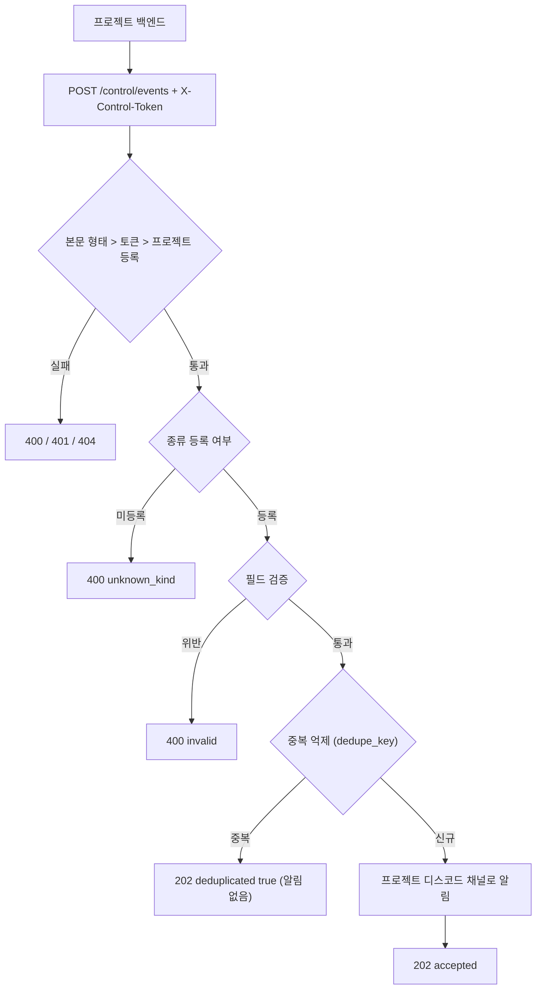

# 앱 이벤트(events) 연동 가이드

프로젝트(서버, 배치, 도구)가 "지금 일어난 일"(에러, 배포 완료, 신고 접수, 인증코드 발급 등)을 관제소로 보내면, 관제소가 그 프로젝트의 디스코드 채널로 알림을 보내는 규격(`events v1`)이다.
보내는 쪽은 **사실(종류, 수준, 제목, 본문)만** 보내고, 어느 채널로 갈지와 누가 볼 수 있는지는 관제소 관리 화면에서 정한다.
이 문서는 **구현된 코드 기준**이다(`router/control_tower_router.py`, `service/control_tower/event_dispatcher.py`).



## 1. 요청

| 항목 | 값 |
|---|---|
| 주소 | `POST https://ai.suhsaechan.kr/api/flask/control/events` |
| 헤더 | `X-Control-Token: <프로젝트 토큰>`, `Content-Type: application/json` |
| 본문 | 아래 필드 표 (JSON 객체), 요청 본문 최대 64KB (넘으면 nginx가 413) |

원본 스키마: [events-v1.schema.json](./events-v1.schema.json) (JSON Schema 2020-12). 예시: [examples/](./examples/) (`valid_*` 유효, `invalid_*` 무효).
스키마의 길이, 개수 상한은 서버 검증기 상수와 같아야 하며 계약 테스트(`test/test_control_tower_events_contract.py`)가 비교한다.

### 필드

| 필드 | 필수 | 규칙 |
|---|---|---|
| `project` | 예 | 관제소에 등록된 프로젝트 id(문자열). 토큰의 주인이기도 하다 |
| `kind` | 예 | 알림 종류. 기본 `report`, `error`, `deploy`, `status`, `info` + 프로젝트별로 추가한 종류. 미등록이면 `unknown_kind` |
| `severity` | 예 | `info` / `warning` / `critical` |
| `title` | 예 | 1~200자 |
| `body` | 아니오 | 2000자 이하 |
| `url` | 아니오 | `https://`로 시작, 2048자 이하 (알림의 링크) |
| `dedupe_key` | 아니오 | 문자열. 같은 (프로젝트, `dedupe_key`)가 10분 안에 다시 오면 **종류가 달라도** 알림 없이 접수만 함(202, `deduplicated: true`). 사건마다 고유하게 짓고 종류를 포함할 것(예 `user-report:42`). 같은 사건의 재시도에는 같은 키를 쓴다 |
| `fields` | 아니오 | `[{ "name", "value" }]` 최대 10개, `name` 1~40자, `value` 1~200자, 둘 다 문자열 |

- 모르는 최상위 필드는 무시한다.
- `info` 종류는 프로젝트 상태 채널로, 그 외 종류는 같은 이름의 채널로 간다. 채널이 없으면 관제-긴급 채널로 대체된다.

## 2. 응답

| 코드 | 본문 | 뜻 |
|---|---|---|
| 202 | `{"accepted": true, "deduplicated": false}` | 접수 완료. 디스코드 발송이 실패해도 접수 응답이다(재전송 불필요) |
| 202 | `{"accepted": true, "deduplicated": true}` | `dedupe_key` 중복. 알림 없음 |
| 400 | `{"error": "invalid", "fields": ["title", ...]}` | 본문이 객체가 아니거나 `project`가 문자열이 아님(`fields: ["project"]`), 또는 필드 규칙 위반(위반 필드 이름 목록) |
| 400 | `{"error": "unknown_kind", "kind": "..."}` | 이 프로젝트에 등록되지 않은 종류. 기록, 알림 없음. `kind`는 50자까지 되돌려 준다 |
| 401 | `{"error": "unauthorized"}` | 토큰 없음, 불일치, 만료된 이전 토큰, 해당 프로젝트 토큰 미설정·폐기 |
| 404 | `{"error": "unknown_project"}` | 토큰은 맞지만 관제소에 등록되지 않은 프로젝트 |
| 503 | `{"error": "unavailable"}` | 관제소 준비 안 됨(기동 중, 설정 오류). 잠시 뒤 재시도 |

처리 순서는 본문 형태 > 토큰 > 프로젝트 등록 > 종류 > 필드 검증이다.

## 3. 토큰

토큰은 프로젝트마다 하나이며, 관제소 관리 화면에서 발급한다. 관제소 서버에 비밀값 `CONTROL_TOWER_SECRET`이 설정되어 있어야 발급할 수 있다(없으면 버튼이 비활성되고 "서버에 CONTROL_TOWER_SECRET이 설정되지 않았습니다"가 보인다).

> **`CONTROL_TOWER_SECRET`은 한 번 정하면 절대 바꾸지 않는다.** 같은 값이 두 곳에 쓰인다. ① 관제소는 토큰을 이 값으로 만든 해시로만 저장하므로, 값을 바꾸면 관리 화면에서 발급한 **모든 프로젝트 토큰이 즉시 401**이 된다. ② [추가로 받을 곳](#6-팀-discord슬랙으로도-받기)의 URL(웹훅 비밀값 포함)을 암호화하는 키이기도 하므로, 값을 바꾸면 **등록한 받을 곳을 전부 복호화할 수 없어** 발송이 `복호화 실패`로 멈춘다. 바꿔야 한다면 관리 화면 토큰을 쓰는 프로젝트마다 토큰을 다시 발급해 앱을 다시 배포하고, 받을 곳도 전부 지우고 다시 등록해야 한다.

**처음 도입할 때 (GitHub Secret에 추가)**: 서버의 Flask `.env`는 **배포할 때마다 GitHub Secret `FLASK_ENV_FILE` 내용으로 다시 만들어진다**(`.github/workflows/SUH-AI-PROJECT-CONTROL.yaml`의 "Flask .env 생성" 단계). 그래서 서버 `.env`를 직접 고치면 다음 배포 때 덮어써져 값이 사라진다.

1. 저장소 Settings > Secrets and variables > Actions > `FLASK_ENV_FILE`을 열고, 기존 내용 끝에 `CONTROL_TOWER_SECRET=<충분히 긴 임의 문자열>` 한 줄을 추가해 저장한다(기존 줄은 그대로 둔다).
2. 다시 배포한다. 배포가 새 `.env`를 올리고 Flask를 재시작하면 적용된다.
3. 이 값은 저장소 파일에 커밋하지 않는다. 같은 값을 안전한 곳(비밀번호 관리자 등)에 따로 보관한다. 위 경고대로 이후에 바꾸지 않는다.

### 3.1 토큰 받기

1. 관제소 관리 화면 > 서비스 관리 > 프로젝트 카드 > **이벤트 토큰** > **토큰 발급**을 누른다.
2. 창에 토큰이 **한 번만** 보인다. 복사해서 보내는 쪽(앱 서버) 환경변수에 넣고 창을 닫는다. 관제소는 토큰의 해시만 저장하므로 다시 보여 줄 수 없다. 잃어버리면 교체한다.
3. 상태 줄에서 관리 방식(환경변수 / 관리 화면), 현재 토큰 발급 시각, 유예 중인 이전 토큰 개수와 그중 가장 늦은 만료 시각을 확인할 수 있다.

### 3.2 교체 절차

1. **토큰 교체**를 누른다. 새 토큰이 현재 토큰이 되고, 지금까지 쓰던 토큰은 이전 토큰으로 **7일 동안** 계속 통과한다.
2. 새 토큰으로 보내는 쪽 앱을 배포한다.
3. 이전 토큰은 교체된 시점부터 각자 7일 뒤 자동 만료된다. 연달아 교체해도(A > B > C) A, B는 각자의 만료 시각까지 계속 통과한다. 단, 유예 중인 이전 토큰은 프로젝트당 **최대 3개**이며, 넘으면 만료가 가장 이른 이전 토큰이 교체 순간 바로 거부된다.
4. 유출 등으로 바로 막아야 하면 **토큰 폐기**를 누른다(현재·이전 토큰 모두 즉시 거부, 다시 발급할 때까지 이 프로젝트 이벤트는 401).

### 3.3 환경변수 토큰 (기존 프로젝트 호환)

- 관리 화면에서 **한 번도 발급하지 않은** 프로젝트는 기존 방식대로 서버 환경변수 `CONTROL_EVENT_TOKEN_<PROJECT>`를 쓴다(`<PROJECT>`는 프로젝트 id를 대문자로, `-`는 `_`로: `suh-ai` > `CONTROL_EVENT_TOKEN_SUH_AI`). 교체 중에는 `CONTROL_EVENT_TOKEN_<PROJECT>_PREVIOUS`에 이전 값을 함께 두면 둘 다 통과한다.
- 관리 화면에서 **한 번이라도 발급하면** 그 프로젝트는 관리 화면 토큰만 인정한다. 환경변수 토큰은 더 이상 통과하지 않으며, 폐기해도 환경변수 방식으로 돌아가지 않는다.
- **주의: 환경변수 토큰을 쓰던 프로젝트(예: elum)는 첫 발급 순간 환경변수 토큰이 바로 막힌다(유예 없음).** 새 토큰으로 앱을 다시 배포할 때까지 그 프로젝트의 이벤트·push는 401이다. 앱 배포를 준비해 둔 뒤 발급한다.
- Java, Python 클라이언트 라이브러리는 이후 단계에서 제공할 예정이다(설계 문서 4단계).

## 4. 알림 종류 추가

기본 5종으로 부족하면 프로젝트별로 종류를 더한다. **코드 변경 없이** 관제소 관리 화면 > 프로젝트 > 알림 종류에서 이름과 공개 대상을 정하면 채널이 만들어지고, 그 종류로 보낼 수 있다.
등록하지 않은 종류를 보내면 `400 unknown_kind`로 거부된다(오타 방지). 예약어(기본 종류, 채널 종류 이름)는 쓸 수 없다. `kind: "attention"` 등 채널 종류 이름을 보내면 `unknown_kind`이며, 확인할 일은 [attention 연동](../attention/README.md)을 쓴다.

## 5. 보내는 방법 (하지 말아야 할 것 포함)

- **모바일 앱에서 직접 보내지 않는다.** 앱에 토큰을 넣으면 추출되어 누구나 알림을 보낼 수 있다. 앱 > **자기 백엔드** > 관제소 순서로 보낸다.
- **개인정보는 보내는 쪽이 판단한다.** 이메일, 인증코드, 토큰, 전화번호는 가급적 넣지 않는다. 필요하면 식별 가능한 최소한(주문 번호 등)만 쓴다.
- **쌓인 개수는 events가 아니라 attention으로 보낸다.** "새 의견 N건", "처리 안 된 신고 N건" 같은 누적 개수는 [attention 가이드](../attention/README.md)가 맞다. events는 한 번 일어나고 끝나는 사건용이다.
- **본 업무를 막지 않는다.** 타임아웃을 짧게(2~5초) 두고, 실패해도 예외를 삼키고 로그만 남기며, 가능하면 비동기로 보낸다. 같은 사건의 재시도에는 같은 `dedupe_key`를 쓰고, 서로 다른 사건과 키가 겹치지 않게 한다.

### curl

```bash
curl -sS -m 5 -X POST "https://ai.suhsaechan.kr/api/flask/control/events" \
  -H "Content-Type: application/json" \
  -H "X-Control-Token: $CONTROL_EVENT_TOKEN" \
  -d '{"project":"suh-ai","kind":"deploy","severity":"info","title":"v1.2.3 배포 완료","url":"https://example.com/releases/1.2.3","dedupe_key":"deploy-1.2.3"}'
```

### Python (requests)

```python
import logging
import requests

CONTROL_EVENTS_URL = "https://ai.suhsaechan.kr/api/flask/control/events"
CONTROL_EVENT_TIMEOUT_SECONDS = 3

def send_control_event(token: str, payload: dict) -> None:
    """관제소 이벤트 전송: 실패해도 본 업무에 영향 없음 (로그만)"""
    try:
        response = requests.post(CONTROL_EVENTS_URL, json=payload, timeout=CONTROL_EVENT_TIMEOUT_SECONDS,
                                 headers={"X-Control-Token": token})
        if response.status_code != 202:
            logging.warning("control event rejected: %s %s", response.status_code, response.text[:200])
    except requests.RequestException:
        logging.warning("control event send failed", exc_info=True)
```

### Java (java.net.http, Java 11+)

```java
private static final URI CONTROL_EVENTS_URI = URI.create("https://ai.suhsaechan.kr/api/flask/control/events");
private static final Duration CONTROL_EVENT_TIMEOUT = Duration.ofSeconds(3);
private final HttpClient httpClient = HttpClient.newBuilder().connectTimeout(CONTROL_EVENT_TIMEOUT).build();

/** 관제소 이벤트 비동기 전송: 실패해도 호출 흐름에 영향 없음 (로그만) */
public void sendControlEvent(String token, String jsonPayload) {
    HttpRequest request = HttpRequest.newBuilder(CONTROL_EVENTS_URI)
        .timeout(CONTROL_EVENT_TIMEOUT)
        .header("Content-Type", "application/json")
        .header("X-Control-Token", token)
        .POST(HttpRequest.BodyPublishers.ofString(jsonPayload))
        .build();
    httpClient.sendAsync(request, HttpResponse.BodyHandlers.ofString())
        .thenAccept(response -> {
            if (response.statusCode() != 202) {
                log.warn("control event rejected: {} {}", response.statusCode(), response.body());
            }
        })
        .exceptionally(error -> { log.warn("control event send failed", error); return null; });
}
```

## 6. 팀 Discord·슬랙으로도 받기

프로젝트 알림은 항상 SUH 관제소 디스코드 채널로 간다(끌 수 없음). 여기에 더해 **팀 디스코드 웹훅, 슬랙, 텔레그램, 메일** 등으로도 같은 알림을 받을 수 있다. 보내는 쪽(앱) 코드는 바꿀 필요가 없다. 관제소가 알림을 보낼 때 등록한 받을 곳에도 함께 보낸다.

- 적용 범위: 그 프로젝트의 모든 알림(앱 이벤트, 감시 다운·복구·지연, 확인할 일 attention). 전역 알림(공지·전체 장애·요약)은 제외.
- 받을 곳은 **(프로젝트, 종류)** 단위로 등록한다. 종류는 알림이 가는 채널 종류이다: 기본 `status`, `error`, `report`, `deploy`, `attention` + 그 프로젝트에 추가한 알림 종류. `info` 이벤트는 `status`로 간다(`info`는 선택지에 없다).

### 6.1 등록하기

1. 서버에 `CONTROL_TOWER_SECRET`이 설정되어 있어야 한다(3장 참고). 없으면 추가·사용 켜기·테스트 버튼이 비활성되고 안내가 보인다(끄기·삭제는 비밀값 없이도 된다).
2. 관제소 관리 화면 > 서비스 관리 > 프로젝트 카드 > **추가로 받을 곳**을 펼친다.
3. 종류를 고르고, 이름(예: `팀 디스코드`)과 URL을 넣고 **받을 곳 추가**를 누른다. URL은 [Apprise](https://github.com/caronc/apprise/wiki) 형식이다.

| 수단 | URL 형식 | 값 얻는 곳 |
|---|---|---|
| Discord 웹훅 | `discord://웹훅ID/웹훅토큰` | 채널 설정 > 연동 > 웹후크 URL `https://discord.com/api/webhooks/웹훅ID/웹훅토큰` |
| Slack | `slack://토큰A/토큰B/토큰C` | Incoming Webhook URL `https://hooks.slack.com/services/토큰A/토큰B/토큰C` |
| Telegram | `tgram://봇토큰/채팅ID` | BotFather 봇 토큰 + 받을 채팅 ID |
| 메일 | `mailto://계정:비밀번호@메일서버` | 보내는 메일 계정 (앱 비밀번호 권장) |

4. 표의 **테스트 발송**(종이비행기) 버튼으로 고정 문구 1건을 바로 보내 결과를 확인한다. 15초 안에 끝나지 않으면 `오류 (Timeout)`으로 표시되지만, 발송 자체는 멈추지 않아 잠시 뒤 실제로 도착할 수 있다.

### 6.2 표 읽기

- **수단**: URL은 화면에 다시 보이지 않는다. 수단과 끝 4자리만 보인다(`discord://…ab12`). URL을 바꾸려면 지우고 다시 등록한다.
- **사용**: 끄면 그 받을 곳으로 보내지 않는다(삭제하지 않고 보관).
- **최근 결과 / 최근 시도**: 마지막으로 보내려고 시도한 결과와 시각이다(성공만이 아니라 모든 시도). `성공`, `실패`(받는 쪽이 거부), `비밀값 없음`(서버에 `CONTROL_TOWER_SECRET` 없음, 발송 생략), `복호화 실패`(비밀값이 바뀜 > 지우고 다시 등록), `오류 (...)`(네트워크 등 예외, 괄호 안은 예외 종류).

### 6.3 보안·동작 규칙

- URL(웹훅 비밀값 포함)은 `CONTROL_TOWER_SECRET`으로 암호화해 저장한다. 관리 화면 응답, 감사 기록, 서버 로그, 오류 응답에는 원문이 남지 않는다(감사 상세는 프로젝트, 종류, 이름, `url_hint`만).
- 발송은 백그라운드에서 받을 곳마다 따로 한다. 한 곳이 실패하거나 느려도 다른 받을 곳, 기본 SUH 관제소 디스코드, 앱 요청 응답에 영향이 없다. 실패는 재시도하지 않고 결과와 경고 로그만 남긴다.
- 같은 알림은 받을 곳에 24시간 안에 1번만 보낸다. 기본 디스코드 발송이 실패해 관제소가 같은 알림을 다시 보내도 받을 곳에는 다시 가지 않는다(중복 발송보다 누락이 낫다).
- 받을 곳은 관리자만 등록할 수 있고, `json://`·`form://` 등으로 내부망 주소도 지정할 수 있다. 관리자 전용 기능이라 의도된 동작이며, 관리 화면 접근 권한을 관리자에게만 둔다.
- 감사 행위: `CONTROL_DESTINATION_CREATE`(추가), `CONTROL_DESTINATION_UPDATE`(사용 전환), `CONTROL_DESTINATION_DELETE`(삭제), `CONTROL_DESTINATION_TEST`(테스트 발송).
