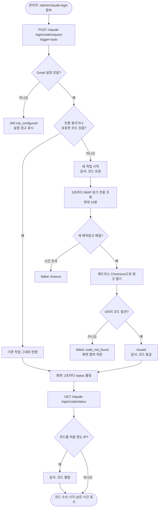

# Claude 로그인 인증코드 대시보드 자동 표시

## 개요

Claude 계정(Gmail 가입)으로 로그인하면 Anthropic이 매직링크 메일을 보내고, 그 링크를 열어야 6자리 인증 코드가 나온다. 지금까지는 매번 Gmail에 들어가 메일을 열고 링크를 눌러 코드를 확인해야 했다.

관리 대시보드에 `/admin/claude-login` 화면을 추가했다. 화면을 열면 서버가 자동으로 메일을 기다리고, 메일이 오면 링크를 헤드리스 브라우저로 열어 6자리 코드를 읽어 보여준다. 화면에는 복사 버튼, 메일 수신 시각, 남은 유효시간, 진행 단계가 나온다. 코드 요청·발급·열람은 감사로그에 IP·브라우저와 함께 남는다.

범위는 **6자리 코드 표시까지**다. 코드를 받아 Claude Code 로그인을 끝까지 자동으로 진행하는 것은 이번 범위가 아니다.

## 기능 흐름

## 변경 사항

### 신규 파일

- `flask/config/claude_login_config.py`: 대기·만료·재시도 시간 상수, Chromium 설치 경로, Gmail 환경변수 이름
- `flask/service/claude_login_mail_client.py`: Gmail IMAP 읽기 전용 조회. Anthropic 발신 메일에서 매직링크 원문만 추출
- `flask/service/claude_login_browser_client.py`: 매직링크를 헤드리스 Chromium으로 열고 6자리 코드 추출
- `flask/service/claude_login_code_service.py`: 작업 상태(대기 > 수신 > 링크 열기 > 발급), 만료, 실패 사유, 발급 감사 기록
- `flask/router/claude_login_router.py`: 대기 시작·상태 조회·실패 캡처 API
- `flask/templates/admin/claude_login.html`, `flask/static/js/claude-login.js`: 코드 카드, 진행 단계, 최근 감사 기록
- 테스트 4개 파일(메일·브라우저·서비스·라우터)

### 기존 파일 수정

- `flask/app.py`, `flask/router/admin_router.py`: 블루프린트와 화면 라우트 등록
- `flask/templates/admin/base.html`, `dashboard.html`: 사이드바 메뉴와 대시보드 카드 추가
- `flask/service/audit_service.py`, `static/js/audit.js`, `templates/admin/audit.html`: `CLAUDE_LOGIN` 카테고리와 행위 3종(요청·발급·열람)
- `flask/requirements.txt`: `playwright==1.64.1`
- `scripts/deploy-flask.ps1`: 배포 시 Chromium을 `C:\AI\playwright-browsers`에 설치(실패해도 배포는 계속)
- GitHub Secret `FLASK_ENV_FILE`: `CLAUDE_LOGIN_GMAIL_ADDRESS`, `CLAUDE_LOGIN_GMAIL_APP_PASSWORD` 추가

## 주요 구현 내용

### 메일 조회: 읽기 전용, 이미 쓴 메일 제외

Gmail은 앱 비밀번호로 IMAP에 접속한다. 일반 비밀번호는 IMAP에서 차단된다. `select readonly`와 `BODY.PEEK[]`로 읽어 메일함의 읽음 상태를 바꾸지 않는다.

- 작업 시작 2분 전 이후에 받은 메일만 쓴다. 대기 화면을 열기 직전에 로그인 버튼을 누른 경우도 받기 위해서다.
- 이미 처리한 Message-ID는 다시 쓰지 않는다.
- Gmail의 `SINCE` 검색은 날짜 단위이고 시간대가 불확실하다. 그래서 검색은 하루 넓게 하고, 정확한 비교는 메일의 `Date` 헤더로 한다.
- IMAP 소켓 타임아웃은 30초다. 연결이 반쯤 끊겨도 작업이 진행 중 상태에 갇히지 않는다.

### 코드 추출: Cloudflare 봇 판정 대응

claude.ai는 Cloudflare Turnstile로 봇을 막는다. 일반 Playwright 헤드리스 브라우저는 차단된다. 아래 두 가지를 **함께** 적용해야 통과했다.

- `--disable-blink-features=AutomationControlled`로 자동화 표식 제거
- User-Agent의 `HeadlessChrome`을 `Chrome`으로 치환

화면이 늦게 그려질 수 있어 0.5초 간격으로 최대 15초 동안 다시 읽는다. 코드를 못 찾으면 화면을 캡처해 실패 화면에 보여준다.

### 감사로그: 누가 코드를 가져갔는지

| 행위 | 기록 시점 | 비고 |
|---|---|---|
| 코드 요청 | 새 작업이 시작될 때만 | 새로고침으로 같은 작업을 다시 받으면 기록 안 함 |
| 코드 발급 | 서버가 코드를 읽었을 때 | 메일 수신 시각 포함 |
| 코드 열람 | 작업별로 IP마다 처음 코드를 받을 때 | 화면 폴링이 2초마다 와도 1건 |

코드 원문, 매직링크, 앱 비밀번호는 감사로그와 로그에 남기지 않는다. 대기 시작 응답에서도 코드를 빼서 **코드는 열람 기록이 남는 status 경로로만** 나간다.

### 화면 동작

- 화면을 열면 자동으로 대기를 시작한다. 이미 유효한 코드가 있으면 지우지 않고 그대로 보여준다.
- 새 메일을 다시 기다리려면 "다시 기다리기"를 누른다.
- 유효시간 10분이 지나면 탭을 열어둔 상태에서도 코드를 숨기고 "유효시간 만료"로 바꾼다.
- 복사는 Clipboard API를 쓴다. 쓸 수 없는 환경이면 코드 텍스트를 선택해 Ctrl+C로 복사하게 한다.

## 검증

- 단위 테스트: 전체 395개 통과
- 로컬 E2E: 실제 로그인 메일로 확인. 메일 입력 후 13초 만에 코드가 표시됨
- 운영 실측(배포 PR #143 병합 후 Windows 서버)
  - 서버 Chromium 설치와 `.env`의 Gmail 설정 키 2개 확인
  - 화면 진입 15:04:30 → 메일 수신 15:04:59 → 코드 획득 15:05:04 (약 5초)
  - **서버 IP에서도 Cloudflare 통과**
  - 감사로그에 요청·발급·열람 3건이 IP와 함께 기록됨
  - 복사 버튼 "복사됨" 확인

## 주의사항

- **Cloudflare 정책 의존:** 봇 판정을 피하는 두 설정은 claude.ai 쪽 정책이 바뀌면 다시 막힐 수 있다. 막히면 실패 사유가 `code_not_found`로 나오고 실패 화면 캡처가 함께 표시된다. 캡처를 먼저 확인한다.
- **`waitress`가 `0.0.0.0:5000`에서 열려 있음(기존 구조):** nginx를 거치지 않고 5000번 포트에 직접 접속하면 API 키 없이 관리 API 전체를 쓸 수 있다. 이번 기능으로 로그인 코드도 그 경로에 포함됐다. Windows 방화벽에서 5000번이 외부에 막혀 있는지 확인해야 한다.
- **운영 API 키 강도:** nginx 인증 키가 짧은 편이다. 이제 관리 API로 로그인 코드도 볼 수 있으므로 더 긴 키로 바꾸는 것을 권장한다.
- **처리한 메일 목록은 메모리에만 있음:** 서버를 재시작하면 2분 안에 이미 쓴 메일을 다시 열 수 있다.
- **남은 작은 개선(이번 범위 밖)**
  - Date 헤더가 이상한 메일이 "브라우저 오류"로 잘못 표시된다.
  - Gmail 오류가 한 번만 나도 대기가 바로 끝난다.
  - 열람 IP 목록이 계속 쌓인다.
  - 실패 캡처는 작업과 상관없이 마지막 파일을 보여준다.
  - Gmail 설정이 없을 때(400) 감사 기록이 남지 않는다.
