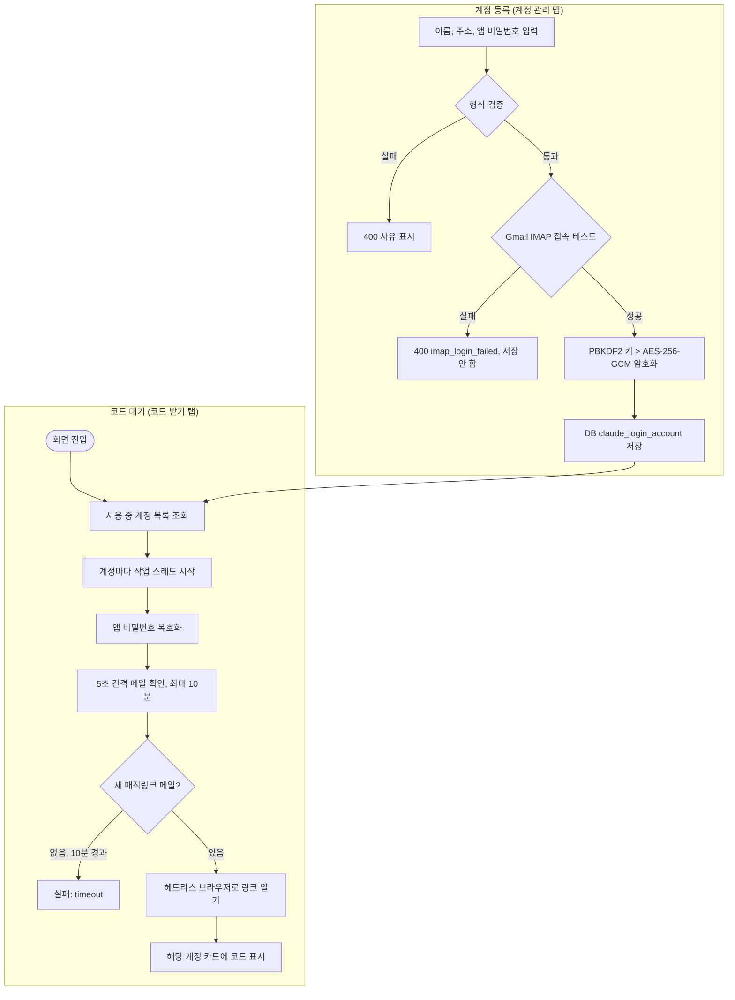

<!-- projectops:report -->
# ⚙️[기능추가][Claude 로그인] 인증코드 다중 Gmail 계정 관리

## 개요

Claude 로그인 인증코드 화면이 `.env`에 적힌 Gmail 계정 1개만 처리하던 구조를, **관리자 화면에서 등록하는 여러 계정**으로 확장했다.
계정 정보는 DB `claude_login_account` 테이블에 저장하고, Gmail 앱 비밀번호는 **AES-256-GCM**으로 암호화한다. 암호화 키의 원본(비밀 문구)은 DB 밖 `.env`의 `CLAUDE_LOGIN_ACCOUNT_SECRET` 하나에만 둔다.
코드 화면은 탭 2개(코드 받기 / 계정 관리)로 나눴고, 화면에 들어오면 사용 중 계정 전부를 동시에 기다려 메일이 온 계정 카드에 6자리 코드를 띄운다.

## 흐름

## 변경 사항

### 저장과 암호화
- `migrations/0004__create_claude_login_account.sql`: 계정 테이블 (주소 UNIQUE, 암호문 BYTEA, `encryption_scheme`, 사용 여부, 마지막 성공·접속 실패)
- `service/claude_login_secret_cipher.py`: 비밀 문구 > PBKDF2-HMAC-SHA256(600,000회, 행별 salt) > AES-256-GCM. 저장 형식 `salt(16) | nonce(12) | 암호문+태그`
- `service/claude_login_account_repository.py`: 계정 CRUD (psycopg2, 감사로그와 같은 `AUDIT_DATABASE_URL`)
- `service/claude_login_account_service.py`: 입력 검증, 접속 테스트 후 저장, 응답에서 비밀번호 제외
- `config/claude_login_config.py`: `CLAUDE_LOGIN_GMAIL_*` 제거, `CLAUDE_LOGIN_ACCOUNT_SECRET` 추가
- `requirements.txt`: `cryptography==47.0.0` 명시

### 코드 대기
- `service/claude_login_code_service.py`: 전역 작업 1개 > **계정별 작업**(계정 간 동시). 처리한 메일 ID·실패 캡처(`logs/claude_login_failure_{id}.png`)도 계정별
- `service/claude_login_mail_client.py`: 등록 전 접속 확인 `verify_login` 추가 (받은편지함 읽기 전용)

### API와 감사
- `router/claude_login_router.py`: `GET/POST /claude-login/accounts`, `PUT/DELETE /claude-login/accounts/<id>`, `POST .../<id>/test`. 코드 API는 `account_id`와 계정별 상태 목록을 다룸. 서비스 예외 > JSON 오류 코드 매핑 한 곳
- `service/audit_service.py`, `static/js/audit.js`: `CLAUDE_ACCOUNT_CREATE/UPDATE/DELETE/TEST` 추가. detail에는 계정 id·주소·바뀐 항목 이름만 남김

### 화면
- `templates/admin/claude_login.html`: 탭 2개, 계정 카드 그리드, 계정 관리 표, 추가·수정 창
- `static/js/claude-login.js`: 코드 받기 탭 (계정 카드, 폴링, 복사, 최근 기록)
- `static/js/claude-login-accounts.js`: 계정 관리 탭 (추가·수정·사용 전환·접속 테스트·삭제)
- `static/css/app.css`: 새 클래스 반영 재빌드

### 문서·테스트
- `docs/claude-login/account-setup-guide.md`: 앱 비밀번호 발급부터 등록까지 안내 (다른 사람에게 전달용)
- `docs/superpowers/specs/2026-11-10-claude-login-multi-account-design.md`: 설계
- 테스트: 암호화 왕복·비밀 문구 불일치, 계정 검증·접속 실패 시 미저장, 계정별 독립 상태·동시 시작, 라우터 오류 매핑·감사에 비밀번호 없음

## 핵심 구현

- **비밀 문구를 키로 쓰는 이유**: 처음 검토한 Windows DPAPI는 같은 PC·같은 서비스 계정에서만 복호화돼 Mac으로 서버를 옮길 수 없다. 비밀 문구 + PBKDF2 방식은 플랫폼과 무관하게 같은 값이면 복호화된다.
- **키를 DB에 두지 않는 이유**: 키가 같은 DB에 있으면 DB 하나만 유출돼도 앱 비밀번호가 풀린다. 그래서 DB에는 암호문만, 키 원본은 `.env`에만 둔다.
- **등록 전 접속 테스트**: 잘못된 앱 비밀번호를 저장해 두고 나중에 코드 대기 중에야 실패하는 일을 막는다. 실패하면 아예 저장하지 않는다.
- **계정별 작업 분리**: 계정 A 작업을 다시 시작해도 계정 B 대기는 그대로다. 작업이 교체되면 이전 스레드는 다음 확인 때 스스로 멈춘다 (`_is_current_job`).
- **코드는 status로만 전달**: request 응답에서는 코드를 빼고, 열람 감사가 붙는 status 응답으로만 준다 (기존 정책 유지, 계정·작업·IP별 1회 기록).

## 검증

- 테스트 1,077건 통과. 로컬에 `psutil`, `ollama` 패키지가 없어 이 작업과 무관한 테스트 파일 5개는 수집하지 못함.
- 실제 화면 확인: 화면·API·암호화·작업 흐름은 실제 코드로 돌리고, DB·Gmail·브라우저만 가짜로 바꾼 로컬 서버를 띄워 브라우저로 확인함. 계정 3개 동시 대기, 메일 온 계정에만 코드 표시, 접속 실패 시 저장 안 됨, 중복 주소 409, 새 계정 즉시 대기, 라이트·다크 테마.

## 주의사항

- **배포 전 필수**: GitHub Secret `FLASK_ENV_FILE`에 `CLAUDE_LOGIN_ACCOUNT_SECRET`을 추가해야 한다. 없으면 화면에 안내가 뜨고 계정 등록·대기가 막힌다.
- **기존 계정 재등록**: `.env`의 기존 Gmail 계정은 자동으로 옮기지 않는다. 배포 후 계정 관리 탭에서 한 번 다시 등록한다. 이전 `CLAUDE_LOGIN_GMAIL_*` 값은 더 이상 쓰지 않는다.
- **비밀 문구는 바꾸면 안 된다**: 바꾸면 저장된 앱 비밀번호를 복호화할 수 없다(카드에 `decrypt_error`). 바꿔야 하면 계정마다 앱 비밀번호를 다시 넣는다. 서버 이전 시에는 DB와 이 값을 함께 옮긴다.
- **DB 의존**: 감사로그와 달리 계정 목록은 DB가 없으면 동작하지 않는다(503 `store_unavailable`). 감사로그의 fail-open 정책은 그대로다.
- **PBKDF2 반복 횟수**: 대기 시작마다 계정별로 키를 한 번 만든다(수백 ms). 계정이 수십 개로 늘면 시작이 느려질 수 있다.
- **남은 일**: 배포 후 실제 Gmail 계정으로 코드 수신까지 실측 확인.
