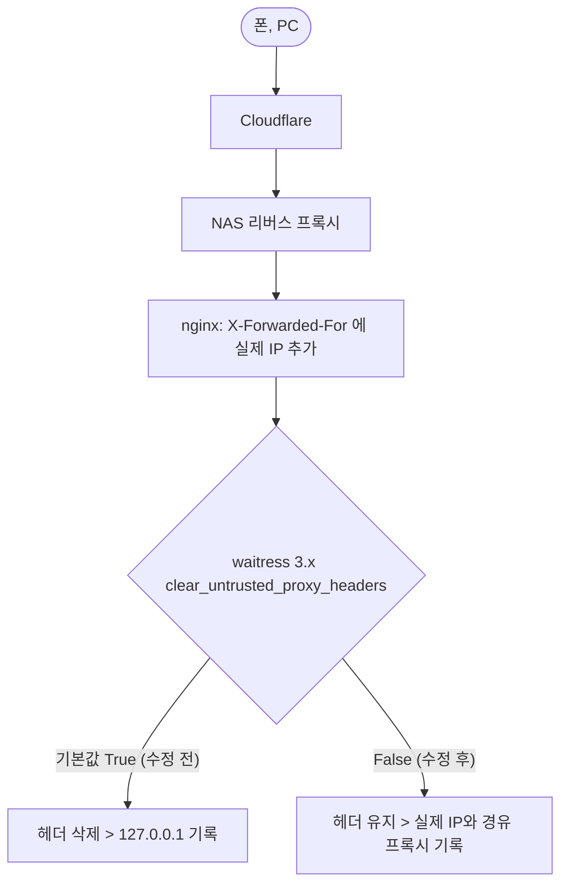

<!-- projectops:report -->
# ❗[버그][감사로그] 11월 8일 이후 클라이언트 IP가 127.0.0.1로만 기록됨

## 개요

감사로그의 클라이언트 IP가 실제 접속 기기 대신 `127.0.0.1`로만 남던 문제를 고쳤다.
원인은 #177 의존성 업그레이드로 waitress 가 2.1.2 > 3.0.2 로 바뀐 것이다. waitress 3.x 는 신뢰 프록시 설정이 없으면 `X-Forwarded-For` 같은 프록시 헤더를 기본으로 지운다. nginx 는 실제 IP를 정상으로 넘기고 있었지만 Flask 에 닿기 전에 사라졌다.

## 흐름

## 변경 사항

- `suh-ai-server/flask/run.py`: `serve(..., clear_untrusted_proxy_headers=False)` 로 nginx 원본 헤더 유지. IP 해석은 기존 `util/audit_helper.client_info` 가 그대로 담당
- `suh-ai-server/flask/test/test_run_server_options.py`: `serve()` 호출에 이 옵션이 빠지면 실패하는 회귀 테스트
- `suh-ai-server/flask/static/js/claude-login.js`: 최근 기록을 코드 요청이 끝난 뒤에 조회 (먼저 조회하면 방금 요청이 목록에서 빠짐), IP·브라우저 열 폭을 줄여 결과 열이 잘리지 않게 함

## 검증

- 원인 재현: waitress 3.0.2 격리 환경에서 기본값은 `X-Forwarded-For` 가 사라지고, `False` 면 그대로 전달됨을 확인
- 서버 nginx access.log: 폰 요청에 실제 IPv6 + Cloudflare IP 가 `X-Forwarded-For` 로 들어오는 것 확인
- 배포 후 서버에서 `X-Forwarded-For: 203.0.113.7, 172.64.0.1` 로 접속 테스트 요청 > 감사로그 `client_ip=203.0.113.7`, `proxy_chain=['172.64.0.1']` 기록 확인
- 테스트 1,078건 통과

## 주의사항

- 11월 8일 23:41 ~ 이번 배포 전까지의 감사로그 IP 는 `127.0.0.1` 로 남아 있다 (복구 불가).
- Flask 는 `0.0.0.0:5000` 으로 열려 있어 내부망에서 nginx 를 거치지 않고 직접 요청하면 `X-Forwarded-For` 를 임의로 넣을 수 있다. waitress 2.1.2 때와 같은 조건이며, 막으려면 Flask 를 `127.0.0.1` 로만 열거나 방화벽으로 5000 포트를 막는다.
- waitress 를 다시 올릴 때 이 옵션을 지우면 같은 문제가 재발한다 (회귀 테스트가 잡음).
