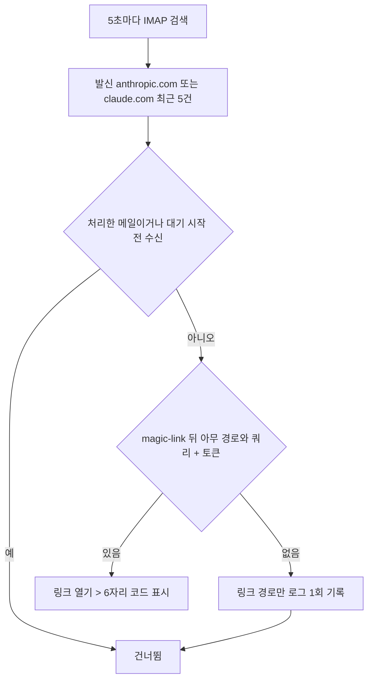

# Claude 로그인 인증코드: 매직링크 경로 형식 변경으로 메일 인식 실패

## 개요

Claude 로그인 메일 링크가 `claude.ai/magic-link/android#토큰` 형식으로 바뀌어, 서버가 메일을 로그인 메일로 인식하지 못하고 "메일을 기다리는 중"에서 10분 동안 멈췄다.
#144에 이어 두 번째 형식 변경이라, 이번 형식만 맞추지 않고 **링크 경로·쿼리·발신 도메인이 바뀌어도 인식**하고 **인식 실패 시 원인이 로그에 남도록** 바꿨다.

## 원인

| 시점 | 메일 속 링크 | 기존 정규식 |
|---|---|---|
| 처음 | `magic-link#토큰` | 인식 |
| 2026-10-31 (#144) | `magic-link?client=...#토큰` | 인식 |
| 2026-11-13 | `magic-link/android#토큰` | **불인식** |

- 기존 정규식은 `magic-link` 바로 뒤에 `?` 또는 `#`만 허용했다. 경로(`/android`)가 끼면 매칭 실패 > 메일을 건너뜀.
- Gmail 접속 테스트는 IMAP 로그인만 확인하므로 정상으로 보였다.
- 메일 발신자(`mail.anthropic.com`)와 링크를 연 뒤의 코드 화면("인증 코드를 사용하여 계속하기")은 바뀌지 않았다. 링크를 직접 열어 6자리 코드가 표시되는 것을 확인했다.

## 변경 사항

`suh-ai-server/flask/service/claude_login_mail_client.py`

- **링크 인식 범위 확대**: `magic-link` 뒤 경로·쿼리 형태와 무관하게 `#토큰`만 있으면 인식 (`/android`, `/ios`, `/android?client=...` 모두 포함). 토큰(`#`)이 없는 안내용 링크는 제외.
- **HTML 엔티티 해석**: href 속성의 `&amp;` 등을 실제 주소로 변환 (쿼리 파라미터가 여러 개 붙는 경우 대비). 작은따옴표 href도 인식.
- **발신 도메인 2개 검색**: `OR FROM anthropic.com FROM claude.com`. Anthropic 메일이 `claude.com` 계열로 옮겨가도 대응. 마케팅 메일이 섞일 수 있어 최근 확인 개수를 3 > 5로 늘림.
- **인식 실패 로그**: 대기 시간 이후 도착한 Anthropic/Claude 메일에서 링크를 못 찾으면 `[claude login] magic link not recognized : message=... claude_paths=...`를 남김.
  - 링크 경로만 기록하고 토큰·쿼리는 남기지 않음
  - 같은 메일은 1번만 기록 (5초 폴링마다 반복 방지)
- 메일 수신 시각·처리 여부를 먼저 판정한 뒤 본문을 해석하도록 순서를 바꿔, 대상이 아닌 메일에 실패 로그가 찍히지 않게 함.

`suh-ai-server/flask/test/test_claude_login_mail_client.py`

- 경로 형식 3종, 작은따옴표, HTML 엔티티, 토큰 없는 링크 제외, 발신 도메인 검색 조건, 실패 로그 1회 기록(토큰 미포함) 테스트 추가.

## 검증

| 항목 | 결과 |
|---|---|
| 메일 클라이언트 단위 테스트 | 21개 통과 |
| Flask 전체 테스트 | 1086개 통과 (5개는 로컬에 `psutil`, `jsonschema` 미설치로 수집 단계 실패, 이번 변경과 무관) |
| 실제 메일함 조회 (읽기 전용) | 수정 코드로 2026-11-13 20:09 수신 메일의 `magic-link/android` 링크 인식 |
| 링크 페이지 | `/android` 링크 > `claude.ai/magic-link` 코드 화면, 6자리 코드 표시 확인 |
| 배포 | PR #191 자동 머지, 서버 배포 워크플로 성공, 서버 `C:\AI\suh-ai-server\flask` 파일에 새 정규식 반영, Flask 서비스 Running |
| 운영 실측 | 관리 페이지에서 로그인 메일 재요청 > 코드 표시 성공 |

## 주의 사항

- **링크 형식은 Anthropic이 예고 없이 바꾼다.** 다시 "메일 기다리는 중"에서 멈추면 Flask 로그에서 `magic link not recognized`를 먼저 확인한다. `claude_paths`에 바뀐 경로가 찍혀 있으면 정규식만 고치면 된다.
- 로그가 없는데 멈춘다면 메일이 검색 조건(발신 도메인, 최근 5건, 대기 시작 2분 전 이후 수신)에서 빠진 것이다. 발신 주소가 `anthropic.com`/`claude.com` 밖으로 바뀌었는지 확인한다.
- 매직링크는 1회용이다. 원인 확인을 위해 링크를 직접 열면 그 메일로는 서버가 코드를 받을 수 없다.
- `/android`는 로그인을 시작한 기기 종류로 보이며, 다른 기기는 다른 경로가 올 수 있다(추정). 이번 변경은 경로 내용과 무관하게 인식하므로 별도 대응은 필요 없다.
