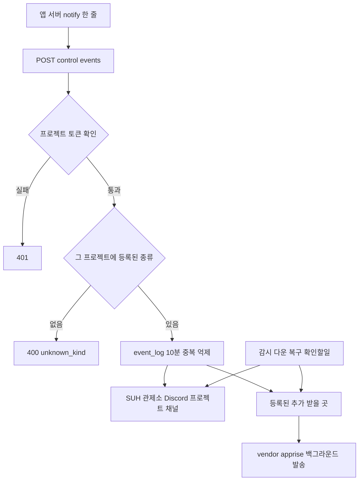

# 관제소 알림 허브: 프로젝트별 알림 종류, 토큰 발급, 받을 곳 등록, 언어별 클라이언트

## 개요

여러 프로젝트 서버에서 민감하거나 운영자가 바로 알아야 하는 사건(Claude 코드 발급, 신고·의견 접수 등)을 Discord로 받기 위한 알림 허브.
각 앱은 관제소에 한 줄로 보내고, **어떤 알림이 있고 어디로 가는지는 관제소 관리 화면 한 곳에서 관리**한다.
알림 종류·토큰·받을 곳을 추가할 때 관제소 코드를 고치거나 다시 배포하지 않는다(확장성 필수 요구).

- 설계: `docs/superpowers/specs/2026-11-13-control-tower-notification-hub-design.md`
- 단계별 구현 계획: `docs/superpowers/plans/2026-11-13-control-tower-notification-hub-stage{1..4}.md`
- PR: #193 (develop 대상)

## 변경 사항

### 1단계: 프로젝트별 알림 종류
- 관리 화면 > 프로젝트 > 알림 종류 추가·삭제. DB(`project_event_kind`)에 두고 실효 등록 정보에 병합.
- 추가하면 그 프로젝트 카테고리에만 Discord 채널 생성. 공개 대상은 등록 파일 `discord.roles`의 역할 키에서 선택(비우면 관리자만).
- 삭제한 종류의 채널은 **이름은 두고 권한만 관리자 전용**으로 보관. 다시 추가하면 원래대로 복원.
- `/control/events`가 기본 5종 + 그 프로젝트 사용자 정의 종류를 받음. 등록 안 된 종류는 `400 unknown_kind` + 경고 로그(조용히 사라지지 않게).
- 이벤트 `fields`(이름·값 최대 10개) 지원, Discord 임베드 필드로 표시.
- Claude 로그인 코드 발급·열람 알림(suh-ai / `claude-code`): 계정 표시 이름·IP·브라우저만, **6자리 코드·Gmail 주소 제외**. 열람 알림은 백그라운드 발송.
- 다른 레포용 연동 문서: `docs/control-tower/events/README.md` + `events-v1.schema.json` + 예시, 스키마 한도를 검증 상수와 테스트로 묶음.
- nginx 이벤트 입구 본문 상한 16KB > 64KB (fields 추가로 규격상 유효한 요청이 막히던 문제).

### 2단계: 프로젝트 이벤트 토큰 발급
- 관리 화면에서 발급·교체·폐기. DB에는 `CONTROL_TOWER_SECRET`에서 파생한 키로 만든 HMAC 해시만 저장, 원문은 발급 응답에 1번만.
- 교체 시 기존 토큰은 각자 7일 유예, 이전 토큰 최대 3개 유지.
- 한 번 발급한 프로젝트는 DB 토큰만 인정(환경변수 토큰 차단), 발급 전 프로젝트는 기존 환경변수 토큰 그대로.
- 이벤트 입구와 attention push 입구가 같은 검증 함수 사용. 비밀값 없음 경고는 10분 간격 제한(외부 요청 로그 폭주 방지).

### 3단계: 추가 받을 곳 (Apprise 벤더링)
- Apprise v2.2.0(BSD-2) 원본을 `suh-ai-server/flask/vendor/apprise/`에 그대로 복사(원본과 바이트 동일 확인, LICENSE 유지), 이후 커밋에서 import 경로만 수정. 기록: `vendor/apprise/VENDORED.md`.
- 관리 화면 > 프로젝트 > 추가로 받을 곳: (종류, 이름, Apprise URL) 등록·사용 전환·삭제·테스트 발송. URL은 암호화 저장, 화면에는 수단+끝 4자리만.
- 관제소의 모든 **프로젝트** 알림(앱 이벤트·감시 다운·복구·확인할 일)이 같은 채널 종류의 받을 곳으로도 감. 전역 알림은 제외.
- 받을 곳 발송은 백그라운드, 기본 Discord 발송·요청 응답을 막지 않음. 복호화 결과 캐시(256개)로 PBKDF2 반복 비용 제거.
- Claude 로그인 Gmail 비밀번호 암호화 모듈을 범용 `secret_cipher`로 옮김(방식·형식 동일, 기존 저장값 그대로 복호화).

### 4단계: 서버용 클라이언트
- `clients/python` (`suh-control-tower`), `clients/java` (`kr.suhsaechan:suh-control-tower-client`) 0.1.0, 외부 의존성 0개.
- `init(project, token)` 한 번, `notify` 한 줄. `notify`는 예외를 던지지 않고 결과(`is_accepted`, `error_code` …)를 돌려줌. 설정 오류는 init 시점에 즉시 예외.
- 리다이렉트 따라가지 않음(토큰 유출 방지), Java는 응답 본문까지 포함한 전체 시간 상한.
- 두 언어가 같은 입력에 같은 본문·같은 결과 코드를 내도록 맞추고, 규격 예시와 같은 본문인지 테스트로 확인.
- **PyPI·Maven Central 게시는 하지 않음** (공개 행위라 사용자 확인 후 별도 진행).

## 왜 이렇게 했나

- **알림 종류를 등록 파일이 아닌 DB(관리 화면)에 둔 이유**: 관리 화면에서 만든 프로젝트도 있고, 토큰·받을 곳도 관리 화면에서 다루므로 한 화면에서 끝나야 함. 기본 5종은 코드 기본값 유지.
- **채널 보관 시 이름을 바꾸지 않는 이유**: `[보관]` 접두사는 Discord가 텍스트 채널 이름을 정규화하면 매 동기화마다 접두사가 다시 붙을 위험(실서버에서 확인 불가). 권한만 바꾸면 이름과 무관하게 같은 결과.
- **동기화 시 등록 정보를 다시 병합하는 이유**: 폴러 캐시(최대 60초)로 동기화하면 방금 추가한 종류의 채널이 곧바로 보관 처리됨. 동기화 버튼과 종류 변경 후 동기화가 같은 함수로 저장소를 다시 읽음.
- **이전 토큰을 여러 개 유지하는 이유**: 교체 창을 닫고 다시 교체하면 운영에 배포된 토큰이 즉시 끊기는 문제(최종 리뷰에서 발견).
- **받을 곳 중복 방지 범위**: Discord 발송 실패 시 폴러·확인할 일이 같은 알림을 다시 dispatch해 팀 채널에 1분마다 쌓이는 문제를 막으려고 관제소 내부 알림(키 있는 것)만 24시간 기억. 앱 이벤트는 이미 event_log에서 10분 억제되므로 기억하지 않음 — 처음 버전은 제목만 같은 다른 신고까지 막는 문제가 있어 재리뷰에서 바로잡음.
- **Apprise를 pip 대신 소스 복사(벤더링)한 이유**: 사용자 결정 — 직접 고쳐 쓰기 위함. Django인 apprise-api는 관제소가 그 역할을 하므로 가져오지 않음.

## 검증

| 항목 | 결과 |
|---|---|
| 서버 테스트 (의존성 전부 설치한 환경) | 1356 passed |
| Python 클라이언트 | 58 passed, `uv build` 성공 |
| Java 클라이언트 | `./gradlew clean test build` 성공 |
| 리뷰 | 단계별 작업 리뷰 + 단계 최종 리뷰 + 수정 재리뷰, Critical·Important 모두 해소 |
| 실서버·브라우저 | **아직** (배포 전). 관리 화면 라이트·다크 렌더, Discord 채널 생성, Claude 코드 알림 실측 필요 |

## 주의 사항

- **`CONTROL_TOWER_SECRET`은 한 번 정하면 바꾸지 않는다.** DB 토큰 해시 키이자 받을 곳 URL 암호화 키. 바꾸면 발급한 토큰 전부 401, 등록한 받을 곳 전부 복호화 실패. 서버 `.env`는 배포 때 GitHub Secret `FLASK_ENV_FILE`로 다시 만들어지므로 **그 Secret에 넣어야 함**(서버 직접 수정은 다음 배포에 덮어써짐).
- 비밀값이 없어도 배포는 안전: 토큰 발급·받을 곳 등록 버튼만 비활성, 기존 elum 환경변수 토큰 연동은 그대로.
- 환경변수 토큰을 쓰던 프로젝트(elum 등)에 관리 화면에서 처음 발급하면 **그 즉시 환경변수 토큰이 막힘**. 앱을 새 토큰으로 재배포할 때까지 401.
- `claude-code` 종류는 배포 후 관리 화면에서 suh-ai에 등록(공개 대상 모두 해제 = 관리자만). 등록 전에는 Claude 코드 알림이 거부되고 경고 로그만 남음.
- 서버 로그 수준은 INFO 이상 유지: urllib3 DEBUG 로그에는 웹훅 경로가 찍힘.
- 받을 곳 중복 기억은 메모리라 Flask 재시작 시 초기화.

## 남은 작업

1. PR #193 develop 반영 > 배포 PR > 서버 배포 > 실측(관리 화면 캡처 포함)
2. GitHub Secret `FLASK_ENV_FILE`에 `CONTROL_TOWER_SECRET` 추가
3. 클라이언트 PyPI·Maven Central 게시 여부 결정
