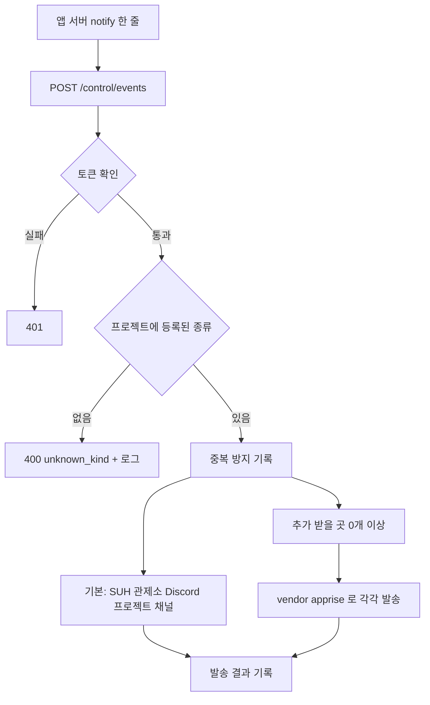

# 관제소 알림 허브 설계: 프로젝트별 알림 종류, 토큰 발급, 받을 곳 등록(Apprise 벤더링), 언어별 클라이언트

## 1. 의도

- 여러 프로젝트(romrom, passql, tripgether …)의 서버에서 **민감하거나 운영자가 바로 알아야 하는 사건**을 Discord로 받고 싶다.
  - 예: "서새찬이 Claude 로그인 코드를 가져감"(suh-ai), "누가 의견을 보냄", "누가 누구를 신고함"
  - 이메일보다 Discord가 잘 보이므로 Discord가 기본 수단
- 알림 종류와 내용은 **서비스마다 너무 다르다.** 관제소가 내용을 정하지 않는다. 각 서비스가 정한다.
- 프로젝트를 하다 보면 팀마다 자기 Discord 서버에 웹훅을 따로 만들어 코드에 박는다. 그러면 웹훅 주소가 레포마다 흩어지고, 무엇이 어디로 가는지 아무도 모른다.
- 지금은 알림 하나 추가하려면 관제소 코드(채널 종류 상수, 이벤트 종류 목록)를 고치고 배포해야 한다. 모든 프로젝트에 같은 채널이 생긴다.

**목표 한 줄:** 각 앱은 관제소에만 한 줄로 보내고, "어떤 알림이 있고 어디로 가는지"는 관제소 한 곳에서 관리한다.

## 2. 현재 상태 (코드 기준, 2026-11-13 develop)

| 구성 | 위치 | 상태 |
|---|---|---|
| 이벤트 입구 `POST /api/flask/control/events` | `router/control_tower_router.py` | 프로젝트 토큰(`X-Control-Token`) 인증. kind 5개 고정 (`report`·`error`·`deploy`·`status`·`info`) |
| 발송 단일 지점 | `service/control_tower/event_dispatcher.py` | (scope, 채널 종류) 바인딩 > Discord 봇으로 임베드 전송. 바인딩 없으면 `#관제-긴급` |
| 채널 종류·이름·공개 범위 | `registry_models.py` (`PROJECT_CHANNEL_KINDS`, `DEFAULT_CHANNEL_NAMES`, `DEFAULT_CHANNEL_VISIBILITY`) | 코드 상수. 프로젝트는 등록 파일 `discord.channels`로 일부만 고를 수 있음 |
| Discord 구조 동기화 | `discord_sync*.py` | 역할 > 카테고리 > 채널 순 자동 생성, 삭제 없음, 빠진 프로젝트는 보관 |
| 앱 확인할 일 (attention v1) | `docs/control-tower/attention/README.md` | 개수·값·상태 스냅샷 규격, 항목별 알림 규칙은 관리 화면에서 설정. **의견·신고 "쌓인 개수" 알림은 이미 이걸로 됨** (elum 사용 중) |
| 프로젝트 토큰 | `app_attention_tokens.py` | 서버 환경변수 `CONTROL_EVENT_TOKEN_<PROJECT>` (+`_PREVIOUS`). 손으로 넣고 재시작 |
| 관리 화면에서 만든 프로젝트 | `custom_project`, `project_override` 테이블 | 등록 파일 + DB 두 출처가 합쳐짐 |
| 비밀값 암호화 | `claude_login_secret_cipher.py` | PBKDF2 > AES-256-GCM (Gmail 앱 비밀번호 저장에 사용 중) |

**알림 두 성격 구분 (이 설계의 기준)**

| | 쌓인 일 (attention, 이미 있음) | 방금 일어난 일 (이벤트, 이 설계의 대상) |
|---|---|---|
| 예 | 새 의견 3건, 미처리 신고 2건, 비용 초과 | Claude 코드 발급, 관리자 로그인, 신고 1건 접수 즉시 |
| 앱이 보내는 것 | 개수·상태 (개인정보 없음) | 앱이 정한 제목·항목·링크 |

## 3. 목표 / 비목표 / 실패 조건

**목표**
- G1. 프로젝트마다 자기 알림 종류를 **코드 수정·배포 없이** 추가한다. 추가하면 그 프로젝트에만 Discord 채널이 생긴다.
- G2. 프로젝트 토큰을 관리 화면에서 발급·교체한다 (서버 환경변수 수작업 제거).
- G3. 알림 종류마다 **추가로 받을 곳**(팀 Discord 웹훅, 슬랙, 텔레그램, 이메일 등)을 관리 화면에서 등록한다. 앱 코드는 바뀌지 않는다.
- G4. Java(Spring)·Python 서버에서 `init` 한 번, `notify` 한 줄로 보낸다.
- G5. Claude 로그인 코드 발급·열람을 첫 사례로 붙인다.

**비목표**
- 모바일 앱(Flutter)에서 직접 보내기: 토큰이 앱에 들어가면 누구나 꺼내 쓸 수 있음. 항상 앱 > 자기 백엔드 > 관제소.
- attention 대체: 쌓인 개수 알림은 attention 그대로.
- 알림 문구 템플릿 엔진: 내용은 보내는 쪽이 완성해서 보냄.
- Discord에서 명령 받기(양방향 봇), 알림 읽음 처리.

**실패 조건 (동작해도 실패로 봄)**
- 웹훅 주소·토큰이 앱 레포·로그·응답·Discord 메시지에 평문으로 남음
- 받을 곳 하나가 실패해서 기본 Discord 채널 발송까지 막힘
- 알림 종류 추가가 여전히 관제소 배포를 요구함

## 4. 접근 방식 (검토한 것)

| 방식 | 내용 | 판단 |
|---|---|---|
| A. 관제소 확장 + Apprise 벤더링 + 언어별 얇은 클라이언트 | 관제소가 종류·채널·권한·토큰·받을 곳을 관리, 다른 수단 발송은 Apprise 소스를 레포에 복사해 고쳐 씀 | **채택** (사용자 결정) |
| B. 각 레포가 Discord 웹훅 직접 | 관제소 변경 없음 | 웹훅 흩어짐, 권한·중복 방지·기록 없음 > 해결하려는 문제 그대로 |
| C. 알림 전용 새 프로젝트 / Novu 도입 | 별도 서비스 운영 | 관제소 기능 중복. Novu는 TypeScript라 이 서버에 붙일 수 없음 |
| D. Apprise를 pip 의존성으로 | 설치만 해서 사용 | 사용자 결정: 직접 고쳐 쓰기 위해 **벤더링** (원본 갱신은 수동) |

## 5. 설계

### 5.1 전체 흐름

### 5.2 프로젝트별 알림 종류 (G1)

- **정의 위치: 관리 화면 (DB).** [내 결정] 등록 파일이 아니라 DB로 둔다. 이유: 관리 화면에서 만든 프로젝트(`custom_project`)도 있고, 토큰·받을 곳도 관리 화면에서 다루므로 한 화면에서 끝나야 한다. 기본 5종은 지금처럼 코드 기본값 유지.
- 새 테이블 `project_event_kind`
  - `project_id`, `kind` (`^[a-z][a-z0-9-]{1,31}$`, 예 `claude-code`, `feedback`), `channel_name` (Discord 채널 이름, 기본 = kind), `visible_to` (등록 파일 `discord.roles`의 역할 키 조합, 관리자는 항상 포함되어 저장 안 함, 빈 목록 = 관리자만, 기본 `dev` (역할 목록에 `dev`가 없으면 관리자만), 등록 파일에서 빠진 역할 키는 동기화에서 건너뜀), `created_at`
  - 기본 5종과 같은 kind는 등록 불가
- 동기화(`discord_sync_plan`)가 프로젝트 채널 목록 = 기본 채널 종류 + 그 프로젝트의 사용자 정의 종류로 계산. 생성·권한은 기존 경로 재사용, 삭제는 지금 정책 그대로 하지 않음(종류를 지우면 채널은 보관 처리).
- `/control/events` kind 검증 = 기본 5종 ∪ 그 프로젝트의 사용자 정의 종류. 모르는 kind는 400 `unknown_kind` + 경고 로그 (오타가 조용히 사라지지 않게).
- 이벤트 본문에 `fields` 추가 (선택): `[{name, value}]` 최대 10개, name 40자, value 200자. Discord 임베드 field로 표시. 기존 `title`·`body`·`url`·`severity`·`dedupe_key` 그대로.
- 종류 추가 후 채널 생성 시점: 저장 즉시 동기화 1회 실행 (지금 기동 시 1회 + 관리 화면 동기화 버튼과 같은 함수).

### 5.3 프로젝트 토큰 발급 (G2)

- 관리 화면 프로젝트 상세에 "이벤트 토큰" 영역: 발급 / 교체 / 폐기.
- 저장은 **해시만** (SHA-256 + 서버 비밀 pepper). 발급 직후 화면에 1번만 보여 주고 다시 보여 주지 않음.
- 교체 = 새 토큰 발급 + 이전 토큰을 "이전"으로 보관(유효 기간 7일 [내 결정]) > 앱이 바꾼 뒤 폐기.
- 검증 순서: **DB 토큰이 한 번이라도 발급된 프로젝트는 DB 토큰(현재·이전)만** 인정. DB 토큰이 없는 프로젝트만 기존 환경변수(`CONTROL_EVENT_TOKEN_*`, `_PREVIOUS`) 허용 [내 결정] (환경변수를 함께 열어 두면 교체·폐기로 유출 토큰을 끊을 수 없음). 기존 연동(elum 등)은 관리 화면에서 발급 전까지 그대로 동작.
- 비밀값 원본: 새 환경변수 `CONTROL_TOWER_SECRET` 1개 > 토큰 해시 pepper와 받을 곳 URL 암호화 키를 여기서 파생 [내 결정] (Claude 로그인 비밀 문구와 분리, 한쪽 교체가 다른 쪽을 깨지 않게). 값이 없으면 토큰 발급·받을 곳 등록 화면만 비활성 + 안내, 기존 환경변수 토큰 인증과 기본 Discord 발송은 그대로. 배포 전 Windows 서버 `.env`에 값 추가 필요.
- attention push 입구도 같은 토큰 검증 함수를 쓰므로 함께 적용.
- 발급·교체·폐기는 감사로그에 기록 (값 없이).

### 5.4 받을 곳 등록 + Apprise 벤더링 (G3)

**벤더링**
- 원본: https://github.com/caronc/apprise (BSD-2-Clause, Python). 받을 곳 관리 서버인 apprise-api(Django)는 가져오지 않음 > 그 역할은 관제소.
- 위치: `suh-ai-server/flask/vendor/apprise/` (패키지 소스만, 테스트·문서 제외)
- 같은 폴더에 원본 `LICENSE` 유지 (BSD-2 조건), `VENDORED.md`에 원본 주소·태그/커밋·복사 날짜·우리가 고친 목록 기록
- import 경로는 `vendor.apprise`로 고정. 필요 의존성 중 없는 것만 `requirements.txt` 추가 (원본 `requirements.txt` 기준으로 확인)
- 복사 후에는 우리 코드: 로그 형식(`[control-tower deliver] ...`), 쓰지 않는 수단 제거는 자유. 단 첫 커밋은 **원본 그대로** 복사만 하고, 수정은 다음 커밋부터 (나중에 차이 비교용)

**받을 곳**
- 새 테이블 `project_event_destination`
  - `id`, `project_id`, `kind` (사용자 정의·기본 종류 모두 가능), `label` (예 "romrom 팀 디스코드"), `url_encrypted` (Apprise URL, 예 `discord://웹훅ID/토큰`), `encryption_scheme`, `is_enabled`, `last_result`, `last_sent_at`
  - URL 암호화: 기존 `claude_login_secret_cipher` 방식(PBKDF2 > AES-256-GCM)을 범용 함수로 정리해 재사용. 키는 `CONTROL_TOWER_SECRET` (5.3)
- 중복 억제된 이벤트(같은 `dedupe_key`)는 받을 곳에도 보내지 않음 [내 결정]
  - 화면에는 수단과 끝 4자리만 표시 (`discord://…ab12`)
- 적용 범위: **관제소의 모든 프로젝트 알림** (앱 이벤트 + 관제소가 감지한 서비스 다운·복구·지연 + attention 알림). 퍼뜨리는 지점은 `EventDispatcher.dispatch` 한 곳 (사용자 결정, 2026-11-13). 전역 알림(`#관제-긴급`·`#관제-요약`)은 대상 아님.
- 발송: 기본 Discord 채널 발송과 **독립**. 받을 곳 하나가 실패해도 나머지·기본 발송에 영향 없음. 실패는 `last_result`와 로그에 남기고 재시도는 하지 않음 [내 결정] (이벤트는 즉시성 알림, 중복 발송보다 누락이 낫다)
- 관리 화면에 "테스트 발송" 버튼 (받을 곳 하나로 고정 문구 1건)
- 기본 SUH 관제소 채널을 끄는 옵션은 두지 않음 [내 결정] (관리자는 항상 전체를 봄)

### 5.5 언어별 클라이언트 (G4)

- 위치: 이 레포 `clients/python/`, `clients/java/` (규격과 같은 곳에서 관리, 새 레포 만들지 않음)
- 공통 동작: `init(base_url, project, token)` > `notify(kind, title, fields=…, body=…, url=…, severity="info", dedupe_key=…)`
  - 보내기 실패가 앱 요청을 막지 않음: 짧은 타임아웃(3초), 예외 대신 결과 반환, 백그라운드 전송 옵션
  - 토큰은 로그에 남기지 않음
- 배포: Python > PyPI, Java > Maven Central (기존 suh-logger·pro-sejong-auth 배포 방식 재사용). 이름은 구현 계획에서 확정.
- **4단계 시작 전 확인할 것** (1~3단계에는 영향 없음): Java·Spring Boot 최소 버전, Spring 자동 설정 필요 여부, Maven namespace·PyPI 계정, 배포 비밀값을 이 레포 CI에 둘지, 클라이언트 버전을 서버 릴리스와 분리할지
- 규격 원본: `docs/control-tower/events/README.md` + `events-v1.schema.json` (attention과 같은 구성). 클라이언트 테스트가 이 스키마 예시를 읽어 검증.

### 5.6 첫 사례: Claude 로그인 (G5)

- 이 레포 안에서는 HTTP 대신 내부 함수 `send_project_event(project_id, kind, title, fields, ...)`로 발송 (같은 검증·발송 경로, 런타임 없으면 조용히 생략).
- suh-ai 프로젝트에 종류 `claude-code` (공개: admin) 등록.
- 보낼 때: 코드 발급 성공, 코드 열람. 항목 = 계정 이름, IP, 브라우저 요약. **6자리 코드와 Gmail 주소는 절대 넣지 않음.**

## 6. 단계 (각 단계 단독 배포 가능)

| 단계 | 내용 | 끝나면 되는 것 |
|---|---|---|
| 1 | 5.2 + 5.6 + 이벤트 규격 문서 | 관리 화면에서 종류 추가 > 채널 생성, Claude 코드 알림 수신 |
| 2 | 5.3 | 새 프로젝트 연동에 서버 작업 불필요 |
| 3 | 5.4 | 팀 Discord·슬랙 등으로도 전달 |
| 4 | 5.5 | 다른 레포에서 라이브러리 한 줄 |

## 7. 빌더에게 맡기는 것

- 테이블 마이그레이션 방식(기존 `store_schema` 열 추가 방식 따름), 관리 화면 배치, 클라이언트 패키지 이름
- Apprise 복사 버전 (최신 안정 태그)
- 사용자 정의 종류 채널의 정렬 순서
- 사용자 정의 kind가 채널 종류 예약어(`attention`, `notice`, `alert`, `digest`)나 기존 채널 이름과 겹치지 않게 막는 검증
- 받을 곳 발송의 동기·비동기 처리 (앱 요청 응답 시간을 늘리지 않는 방향)
